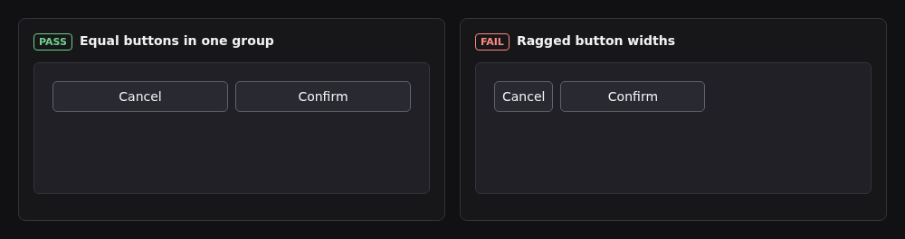
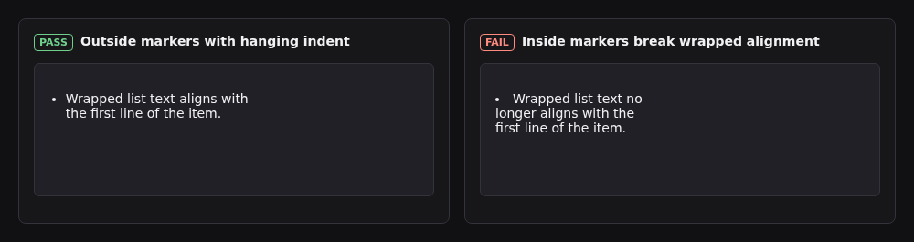
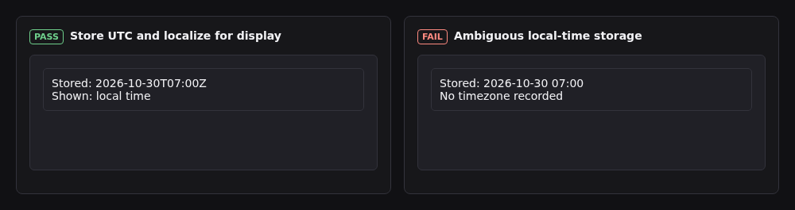
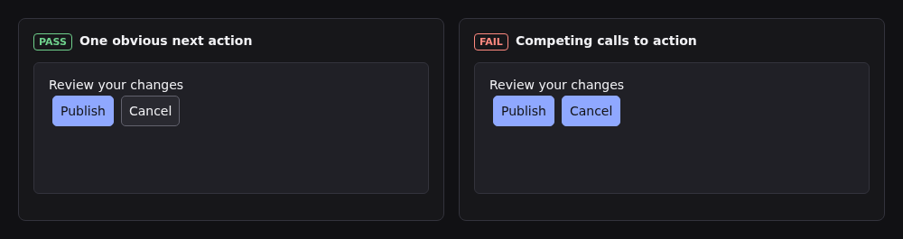
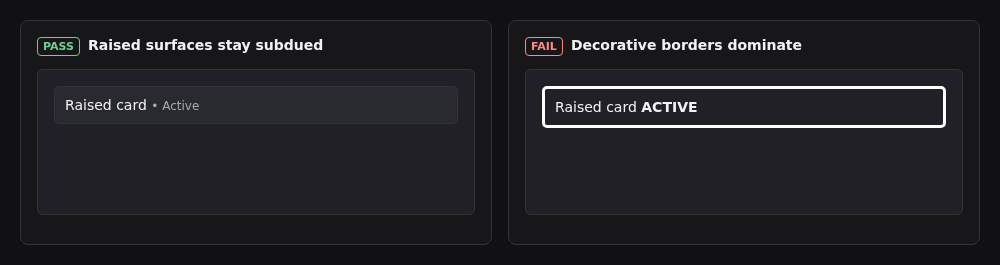
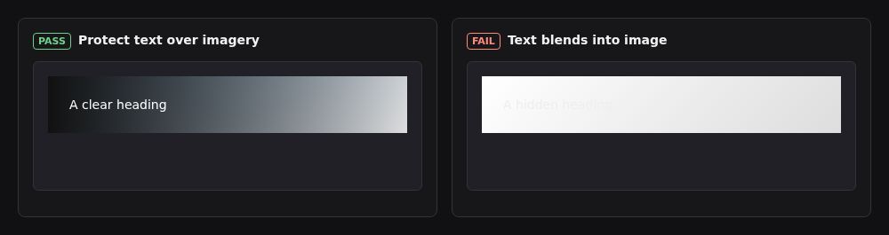
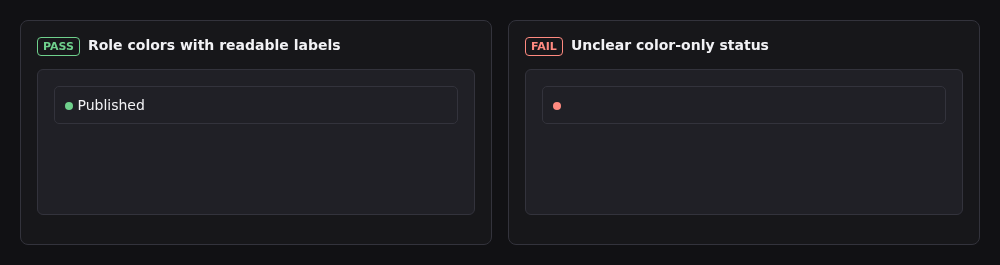
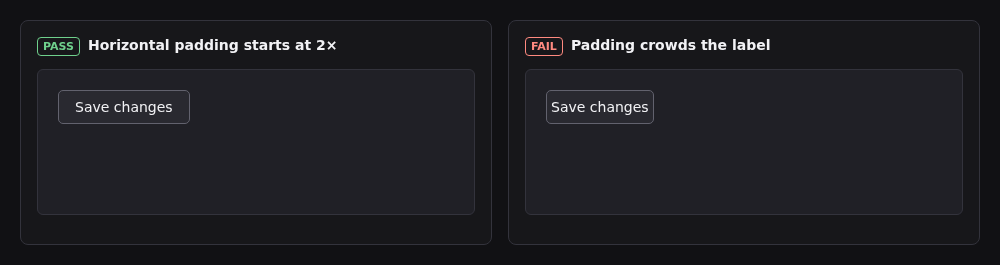
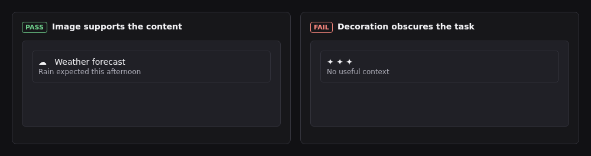
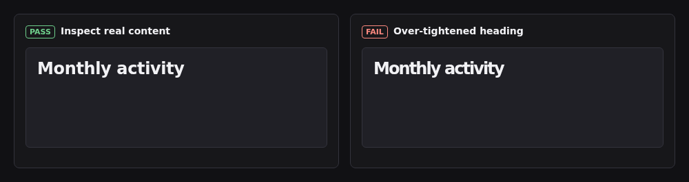

# Examples

One dark-mode UI pair per visual clause, recipe, and audit rule. The left card (`PASS`) follows the house sheet and recipes. The right card (`FAIL`) shows the anti-pattern.

The image files sit in `examples/` beside this page.

## 1. One glyph ladder, one grid

Pass: Lucide chevron on its `24x24` grid (`stroke-width="2"`) and a plain text label when no glyph exists. Fail: a filled non-provider wedge and a missing-glyph box (`ICN001`).

## 2. One icon size per surface

Pass: match toolbar glyphs to the text line height and use a consistent size on that surface. Standalone icons may use a different size. Fail: mixed `14`, `18`, and `24 px` icons on one row (`ICN101`).

## 3. Colour is named by its job

Pass: semantic role tokens (`--bg`, `--surface`, `--accent`, `--text`). Fail: hardcoded hex literals inside component rules or status conveyed by color alone.

## 4. One role set feeds both schemes

Pass: `:root` + `@media (prefers-color-scheme: dark)` + `:root[data-theme]` with a 3-way theme selector (`System`, `Light`, `Dark`) and centered Lucide `monitor`, `sun`, and `moon` glyphs. Fail: a binary toggle that overrides the OS preference.

## 5. Nine-step type ramp and bundled fonts

Pass: the nine sizes are `11, 12, 14, 16, 18, 22, 24, 28, and 32 px`, with weights `400, 500, 600, 700`. Start at `32/18/14 px` for title, body, and small text, or `24/16/12 px` for dense dashboards. Count the `11 px` uppercase `.eyebrow` toward the per-view size limit (`TYP001`). Fail: off-ramp `15 px` body, weight `800`, and proportional IDs.

## 6. Four-pixel spacing scale and concentric radii

Pass: use the `4 px` scale, a `32 px` row, a `6 px` radius, and no shadow by default. Use `32x32 px` icon buttons with a `24x24 px` minimum. Make buttons within each group equal in size (`HRC102`). Fail: off-scale `13 px` gap, `9 px` radius, an excessive dark-theme shadow, `18x18 px` icon button, and ragged button widths in a group.

## 7. Compact named breakpoints

Pass: `68em` (`1088px`), `60em` (`960px`), and `30em` (`480px`) width plus `24em` (`384px`) max-height in `em` with `0 px` horizontal overflow (`SPC206`). Fail: arbitrary pixel breakpoints and clipped mobile tables.

## 8. One motion curve

Pass: `cubic-bezier(0.22, 1, 0.36, 1)` over `100-150 ms` for hover/press and `160-220 ms` for panels with vendored GSAP and `prefers-reduced-motion: reduce`. Fail: a `450 ms` overshoot spring that ignores reduced motion (contrast needs separate verification).

## 9. Every control and list state is drawn

Pass: default, hover, `:focus-visible` (`2 px` solid `var(--focus)` with `2 px` offset), active, disabled, and fixed-slot loading (`ACC202`, `ACC205`). Fail: `outline: none` and hover rules that grow control dimensions (`ACC201`, `ACC204`).

## 10. Optimistic writes and page memory (`recipes/page-memory.md`)

Pass: immediate pending row reconciled under the same ID, with tab/filter/draft state persisted in URL query parameters or `localStorage`. Fail: frozen form, duplicate row on retry, and lost view state on reload.

## 11. Record the design system

Pass: record reusable patterns in the design document. Fail: leave a new component undocumented.

## 12. Measure across house viewports before landing

Pass: computed padding, gap, font size, and contrast verified at `1920x957`, `1080x2437`, `958x958`, `411x799`, and `855x325`. Fail: single desktop width checked by eye.

## 13. A new pattern ships with its spec entry and viewport shots

Pass: `docs/design.md` entry, recipe, and all five house viewport screenshots in one PR. Fail: one-off page widget missing from `docs/design.md`.

## 15. Outside list markers

Pass: use an outside marker and a `2ch` hanging indent. Fail: put markers inside the text area and misalign wrapped lines.

## 16. Heading and body line-height bands

Pass: headings (`h1` to `h6`) within `1.1` to `1.3x` font-size (`1.2x` default) and non-heading prose within `1.3` to `1.5x`. Fail: loose `1.65x` heading or cramped `1.05x` body copy (`TYP101`).

## 17. Heading-only negative letter-spacing

Pass: headings (`h1` to `h6`) tracked within `-0.005em` to `-0.03em` (`-0.015em` default) and non-heading prose at `0`. Fail: over-tightened `-0.05em` heading or tracked body copy (`TYP102`).

## 18. Left-aligned multi-line prose

Pass: left-aligned (`text-align: start`) prose over `3` lines and short centered hero callouts of at most `3` lines. Fail: centered prose over `3` lines or `text-align: justify` (`TYP103`).

## 19. Standalone prose container and measure width

Pass: multi-line prose and its standalone container sized within `50` to `75ch` (`65ch` default) so `SPC201` ink ratio stays full without exemptions. Fail: `105ch` full-bleed lines or narrow `30ch` standalone prose (`TYP201`).

## 20. Card and dialog font-size hierarchy

Pass: at most `2` ramp font sizes per card or dialog and `3` per view, varying font-weight and `--muted` first. For landing pages and content sites, use up to `6` sizes per view when needed. Fail: `3` distinct font sizes inside one card (`HRC101`).

## 21. Proximity spacing between and within groups

Pass: start inter-group gaps at `2x` intra-group gaps, with a `1.5x` minimum. Snap both to the Clause 6 scale (`4 px` intra, `16 px` inter). Fail: `12 px` label-to-input gap exceeding an `8 px` field-group gap (`SPC101`).

## 22 and 23: Inline card alignment, fonts, and primary actions

Pass: align stacked card items on one inline edge. Use house fonts, uppercase only for `.eyebrow`, and one explicit primary action (`Delete repo`). Fail: ragged inline insets, decorative fonts, uppercase prose, or competing `Yes`/`No` primary buttons (`SPC102`, `HRC001`).

## 24. Store unambiguous timestamps

Pass: store UTC or an explicit numeric offset and localize the display. Fail: store a timestamp without a timezone.

## 25. Plan around the user goal

Pass: identify the goal, main flow, and states before refining the visual treatment. Fail: add competing actions before the task is clear.

## 26. Dark surfaces

Pass: distinguish a raised surface with a subtle surface color while preserving text contrast. Fail: use a bright decorative border that dominates the content.

## 27. Text over images

Pass: use a local treatment when needed and check the actual image. Fail: place light text on a light image without sufficient contrast.

## 28. Balance and focus

Pass: make the primary action clear. Fail: give competing actions equal primary emphasis.

## 29. Brand and role color

Pass: pair a role color with a clear status label and check contrast against its background. Fail: convey status through color alone.

## 30. Text-button padding

Pass: start with `16 px` horizontal and `8 px` vertical padding on the 4 px scale. Fail: crowd the label with `4 px` horizontal padding.

## 31. Relevant imagery

Pass: use imagery that supports the content. Fail: use decoration without a task purpose.

## 32. Check real heading text

Pass: inspect the real content in the selected typeface and loosen tracking when needed. Fail: tighten text until letters collide.

## Recipe and Audit-Rule Examples

- **Modal `.close-button` and confirmation (`recipes/modal-manager.md`):**
  
  
  
- **Range sliders (`recipes/range-sliders.md`):**
  
- **Relative timestamps (`recipes/relative-timestamps.md`):**
  
- **Fixed-slot loading (`recipes/loading-bar.md`):**
  
- **Scrollbars (`recipes/scrollbars.md`):**
  
- **Overflow and anti-clipping (`recipes/overflow-and-clipping.md`):**
  
- **Live dot (`recipes/live-dot.md`):**
  
- **Measure and density rules (`SPC001`–`HRC102`):**
  
  
