# Examples

One dark-mode UI pair per visual clause, recipe, and audit rule. The left card (`PASS`) follows the house sheet and recipes; the right card (`FAIL`) shows the corresponding anti-pattern.

The image files sit in `examples/` beside this page.

## 1. One glyph ladder, one grid

Pass: Lucide chevron on its `24x24` grid (`stroke-width="2"`) and a plain text label when no glyph exists. Fail: a filled non-provider wedge and a missing-glyph box (`NUI001`).

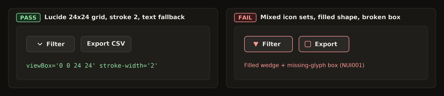

## 2. One icon size per surface

Pass: every toolbar glyph at `16x16 px` (`20x20 px` for standalone hero icons only) so buttons keep one height and baseline. Fail: mixed `14`, `18`, and `24 px` icons on one row (`NUI003`).

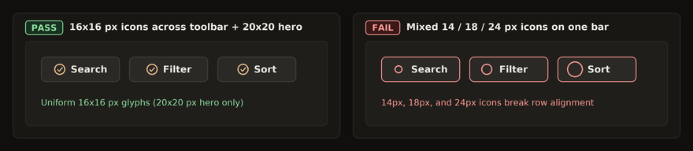

## 3. Colour is named by its job

Pass: semantic role tokens (`--bg`, `--surface`, `--accent`, `--text`). Fail: hardcoded hex literals inside component rules (`NUL002`).

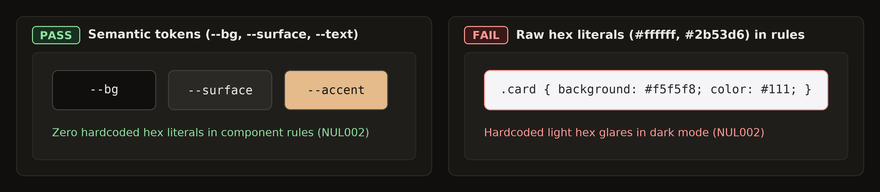

## 4. One role set feeds both schemes

Pass: `:root` + `@media (prefers-color-scheme: dark)` + `:root[data-theme]` with a 3-way theme selector (`System`, `Light`, `Dark`) and centered Lucide `monitor`, `sun`, and `moon` glyphs. Fail: a binary toggle that overrides the OS preference.

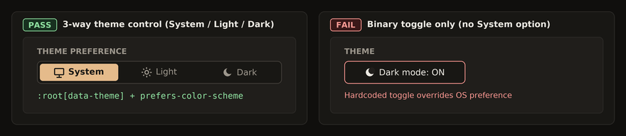

## 5. Seven-step type ramp and bundled fonts

Pass: `11, 12, 14, 16, 18, 22, and 28 px` sizes, weights `400, 500, 600, 700`, `11 px` uppercase `.eyebrow`, and tabular monospace IDs (`NUM202`). Fail: off-ramp `15 px` body, weight `800`, and proportional IDs.

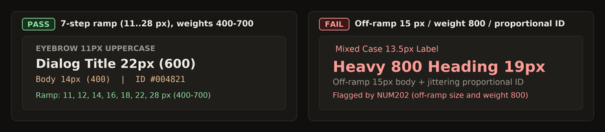

## 6. Four-pixel spacing scale and concentric radii

Pass: `4 px` scale (`4, 8, 12, 16, 24, 32, 48 px`), `32 px` row, `6 px` radius, no box-shadow, and `32x32 px` symmetric icon buttons (`>= 24x24 px` floor, `NUA303`). Fail: off-scale `13 px` gap, `9 px` radius, drop shadow, and `18x18 px` icon button.

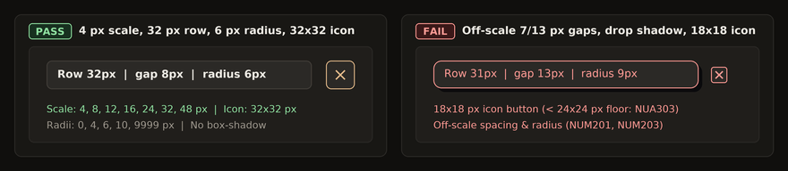

## 7. Compact named breakpoints

Pass: `68em` (`1088px`), `60em` (`960px`), and `30em` (`480px`) width plus `24em` (`384px`) max-height in `em` with `0 px` horizontal overflow (`NUB101`). Fail: arbitrary pixel breakpoints and clipped mobile tables.

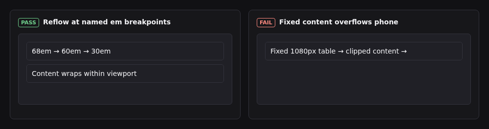

## 8. One motion curve

Pass: `cubic-bezier(0.22, 1, 0.36, 1)` over `100-150 ms` for hover/press and `160-220 ms` for panels with vendored GSAP and `prefers-reduced-motion: reduce`. Fail: a `450 ms` overshoot spring that ignores reduced motion (`NUA306`).

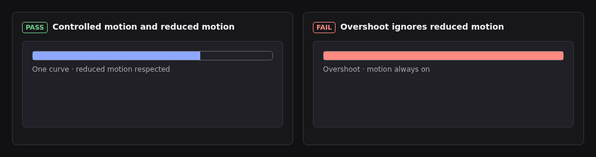

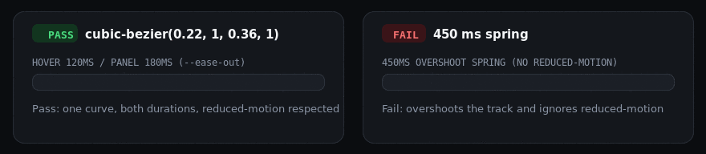

## 9. Every control and list state is drawn

Pass: default, hover, `:focus-visible` (`2 px` solid `var(--focus)` with `2 px` offset), active, disabled, and fixed-slot loading (`NUA304`, `NUA307`, `NUA309`). Fail: `outline: none` and hover rules that grow control dimensions (`NUL003`, `NUL005`).

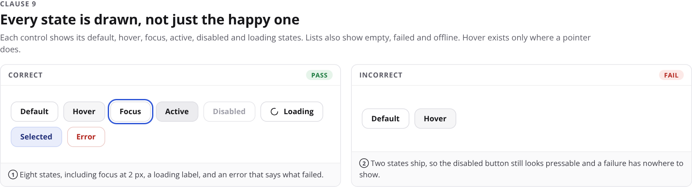

## 10. Optimistic writes and page memory (`recipes/page-memory.md`)

Pass: immediate pending row reconciled under the same ID, with tab/filter/draft state persisted in URL query parameters or `localStorage`. Fail: frozen form, duplicate row on retry, and lost view state on reload.

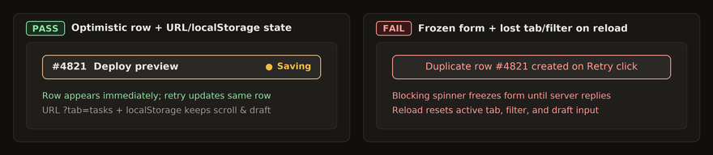

## 12. Measure across house viewports before landing

Pass: computed padding, gap, font size, and contrast verified at `1920x957`, `1080x2437`, `958x958`, `411x799`, and `855x325`. Fail: single desktop width checked by eye.

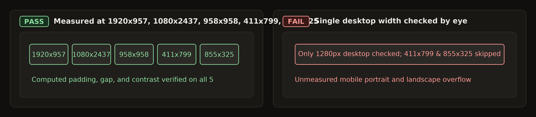

## 13. A new pattern ships with its spec entry and viewport shots

Pass: `docs/design.md` entry, recipe, and all five house viewport screenshots in one PR. Fail: one-off page widget missing from `docs/design.md`.

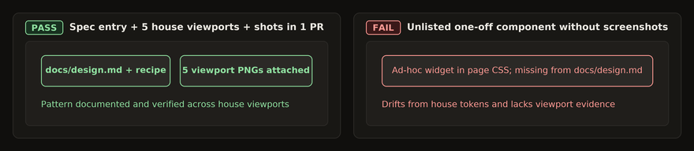

## 16. Heading and body line-height bands

Pass: headings (`h1` to `h6`) within `1.1` to `1.3x` font-size (`1.2x` default) and non-heading prose within `1.3` to `1.5x`. Fail: loose `1.65x` heading or cramped `1.05x` body copy (`NUM212`).

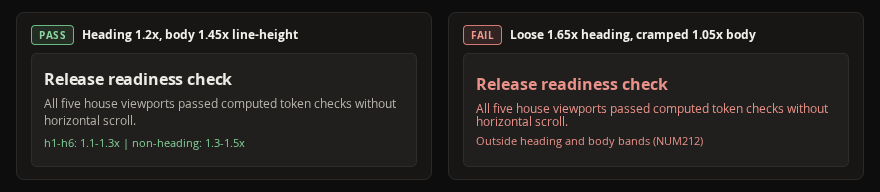

## 17. Heading-only negative letter-spacing

Pass: headings (`h1` to `h6`) tracked within `-0.005em` to `-0.02em` (`-0.015em` default) and non-heading prose at `0`. Fail: over-tightened `-0.05em` heading or tracked body copy (`NUM213`).

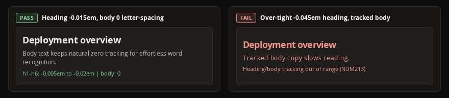

## 18. Left-aligned multi-line prose

Pass: left-aligned (`text-align: start`) prose over `3` lines and short centered hero callouts of at most `3` lines. Fail: centered prose over `3` lines or `text-align: justify` (`NUM214`).

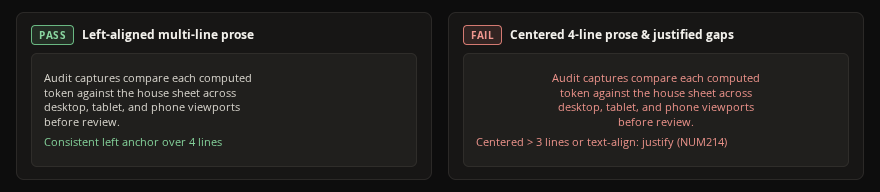

## 19. Standalone prose container and measure width

Pass: multi-line prose and its standalone container sized within `50` to `75ch` (`65ch` default) so `NUM205` ink ratio stays full without exemptions. Fail: `105ch` full-bleed lines or narrow `30ch` standalone prose (`NUM215`).

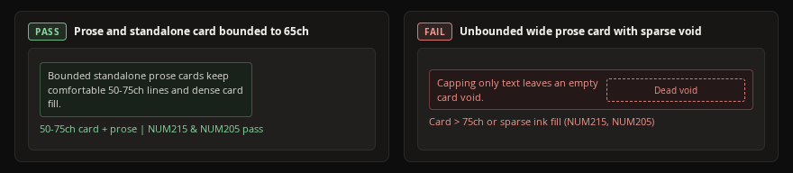

## 20. Card and dialog font-size hierarchy

Pass: at most `3` ramp font sizes per card or dialog, varying font-weight and `--muted` before introducing new sizes. Fail: `4` or more distinct font sizes inside one card (`NUM216`).

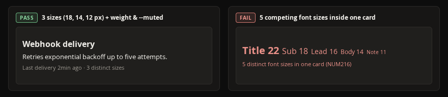

## 21. Proximity spacing between and within groups

Pass: inter-group gaps at least `1.5x` intra-group gaps while both snap to the Clause 6 spacing scale (`4 px` intra, `16 px` inter = `4.0x`). Fail: `12 px` label-to-input gap exceeding an `8 px` field-group gap (`NUM217`).

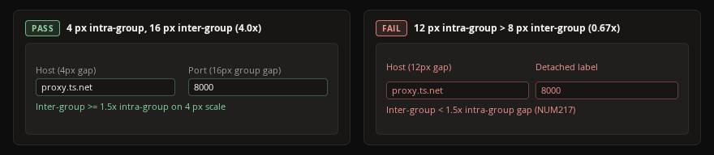

## 22 & 23. Inline card alignment, house fonts, uppercase discipline, and primary actions

Pass: stacked card items aligned on one inline edge, house font tokens (`--font-sans`, `--font-mono`), uppercase limited to `.eyebrow`, and one explicit primary verb button (`Delete repo`). Fail: ragged inline insets, decorative fonts, uppercase prose, or competing `Yes`/`No` primary buttons (`NUM218`, `NUL008`).

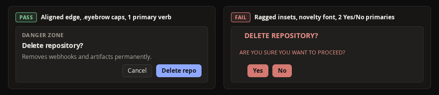

## Recipe and Audit-Rule Examples

- **Modal `.close-button` and confirmation (`recipes/modal-manager.md`):**
  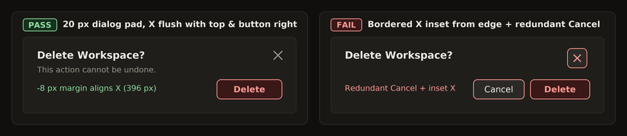
  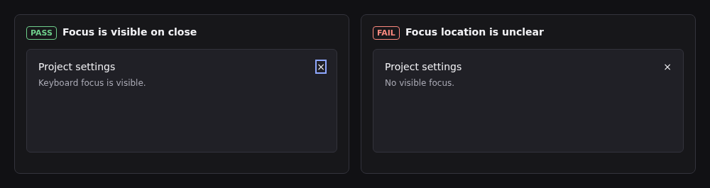
  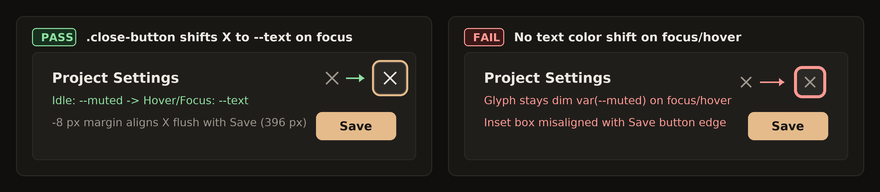
- **Range sliders (`recipes/range-sliders.md`):**
  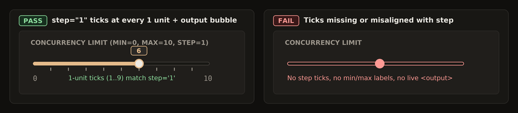
- **Relative timestamps (`recipes/relative-timestamps.md`):**
  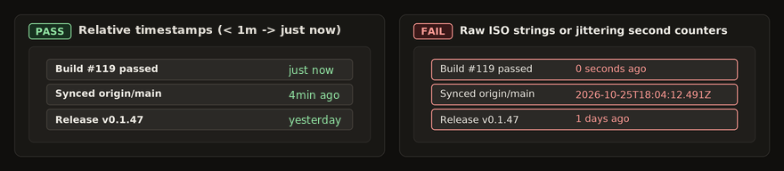
- **Fixed-slot loading (`recipes/loading-bar.md`):**
  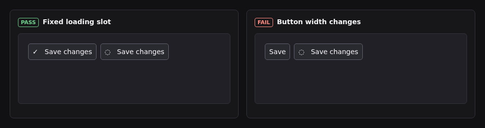
- **Scrollbars (`recipes/scrollbars.md`):**
  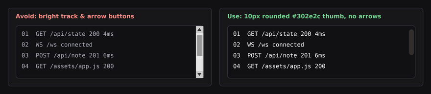
- **Overflow and anti-clipping (`recipes/overflow-and-clipping.md`):**
  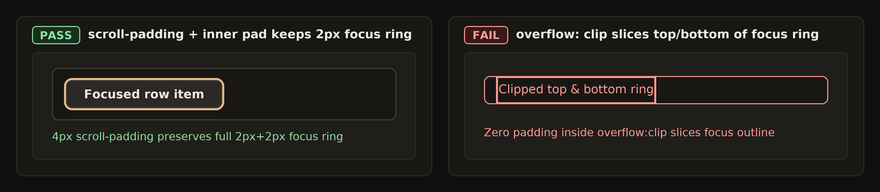
- **Live dot (`recipes/live-dot.md`):**
  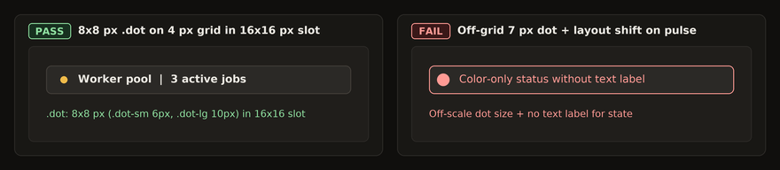
- **Measure and density rules (`NUM201`–`NUM208`):**
  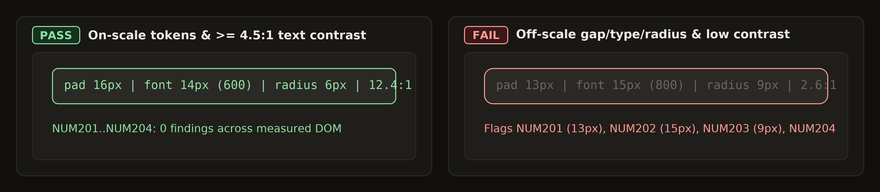
  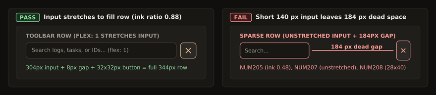
