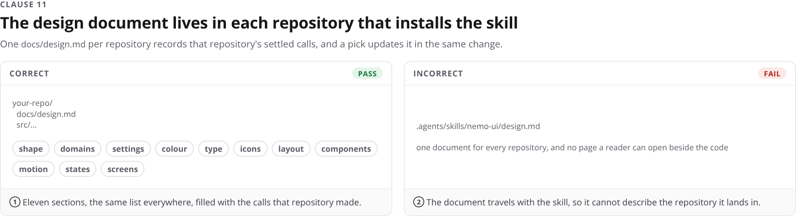

# Examples

One pair per clause. The left panel is correct, the right panel is incorrect, and each pair comes from one stylesheet with one deliberate difference. A vision-capable model reads the images; a text model reads the clause and `style.css`.

The files sit in `examples/` beside this page.

## 1. One glyph, one path

Correct: one lucide chevron on its 24 px grid, stroked at 2, and a word where no glyph exists. Incorrect: a second icon set, filled, and a missing glyph drawn as a box.

## 2. One icon size per surface

Correct: every glyph at 18 px, so the buttons keep one height and one baseline. Incorrect: 14, 18, and 24 px on one row.

## 3. Colour is named by its job

Correct: the same pixels asked for by role. Incorrect: the same pixels frozen as hex literals, which dark mode leaves behind.

## 4. One role set feeds both schemes

Correct: one component resolving in light and dark, with System as a real choice. Incorrect: two hand-made palettes that drift until the dark card loses its label.

## 5. A short type ramp in one family

Correct: four sizes from the ramp, three weights, and a tabular ID. Incorrect: sizes that appear nowhere, a weight the family does not pair, and a proportional ID.

## 6. One spacing scale

Correct: every gap on the 8 px scale, a 40 px row, a 10 px radius, no shadow, a 44 px target. Incorrect: three off-scale sizes and a shadow.

## 7. Three named breakpoints

Correct: 1200, 900, and 640 with one deliberate change each. Incorrect: a 742 px width with its own behaviour, and a table that overflows at 360 px.

## 8. One motion curve

Correct: the same curve and band on every transition, and the end state under reduced motion. Incorrect: a second curve at 400 ms that ignores the preference.

## 9. Every state is drawn

Correct: default, hover, focus, active, disabled, and loading on one control, plus empty, failed, and offline on the list. Incorrect: two states, with hover bound to a touch surface.

## 10. A write shows its row at once

Correct: the pending row appears before the reply, and one retry keeps one row. Incorrect: a frozen form, then a duplicate row after the retry.

## 11. The design document lives in each repository

Correct: `docs/design.md` in the repository, edited in the same change. Incorrect: one copy that ships with the skill and describes no page.

## 12. Measure before landing

Correct: a measured row at 1280 and 360, with the values beside the sheet. Incorrect: one width, read by eye.

## 13. A new pattern needs an entry and a shot

Correct: the pattern, both widths, and the screenshots in one pull request. Incorrect: a pattern that shipped on one page and appears nowhere else.

