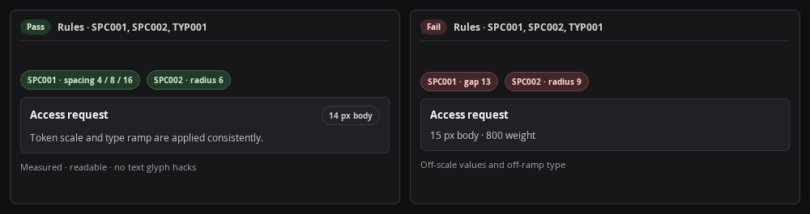
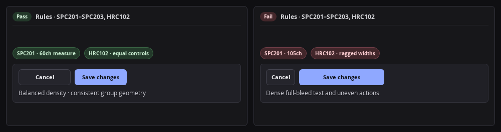

# `nuu` CLI Reference

`scripts/nuu` (`scripts/nuu.py`) is the Python command-line entry point for UI/UX audits, browser walks, redline measurements, screenshot annotations, composite design boards, static lint, marker collection, catalog search, and environment checks.

## Subcommands and Flags

| Command | Positional and required args | Optional flags (with defaults) | Output |
| --- | --- | --- | --- |
| `nuu audit` | None | `-c, --config <toml>` (`./nuu.toml`), `-u, --url <http-url>`, `-o, --output <md>` (`stdout`), `-d, --artifacts <dir>` (`./nuu-artifacts`), `-x, --executable <bin>` (`$CHROMIUM_BIN`), `-t, --timeout <sec>` (`20`) | `7`-section Markdown report (`stdout` or `-o`) + PNG captures in `-d` |
| `nuu walk` | `[verb_or_target]` (`http://127.0.0.1:1500`, `<port>`, `<html-path>`, `<walk.py>`, or MCP `<verb> [args...]`) | `-c, --config <toml>` (`./nuu.toml`), `-S, --session <name>` (`default`), `-o, --output <dir>` (`./nuu-artifacts`), `-g, --gif <gif>`, `--video [webm]`, `-t, --timeout <sec>` (`20`), `-x, --executable <bin>` (`$CHROMIUM_BIN`) | ARIA snapshot / verb text on `stdout` + view PNGs, `.gif`, or `.webm` in `-o` |
| `nuu measure` | `(-u, --url <http-url> \| -i, --input <png>)` + `(-s, --selector <css> \| -d, --drop <x,y[,xy\|x\|y]>)` + `-o, --output <png>` | `-c, --config <toml>` (`./nuu.toml`), `-d, --drop <x,y[,xy\|x\|y]>` (repeatable), `-T, --tolerance <0..255>` (`30`), `--to <css\|x,y>`, `--from <x,y>`, `-k, --scale <4\|8>` (`[measure].scale`), `-v, --viewport <WxH>` (`[audit].viewports[0]`), `-x, --executable <bin>` | Annotated redline PNG at `-o` + Markdown measurement table on `stdout` |
| `nuu annotate` | `(-i, --input <png> \| -u, --url <http-url> [-s, --selector <css>]...)` + `-o, --output <png>` | `-c, --config <toml>` (`./nuu.toml`), `-b, --box <x,y,w,h[,color]\|css[,color]>` (rep), `-l, --label <x,y,text[,color]\|css,text[,color]>` (rep), `-a, --arrow <x1,y1,x2,y2[,color]\|css1,css2[,color]>` (rep), `-n, --callout <x,y,num[,label[,color]]\|css,num[,label[,color]]>` (rep), `-C, --crop <x,y,w,h\|css[,pad]\|auto\|pad\|none>` (`[annotate].crop`), `-S, --scale <1..6>` (`[annotate].scale`), `-v, --viewport <WxH>` (`[audit].viewports[0]`), `-x, --executable <bin>` | Annotated dark-mode PNG at `-o` (never overwrites `-i`) |
| `nuu board` | `-o, --output <png_or_dir>` | `-c, --config <toml>` (`./nuu.toml`), `-T, --type <preset>` (`[board].type`), `-O, --only <board_name>` (rep), `-t, --title <text>`, `-p, --panel <[Label=]src[@x,y,w,h]>` (rep), `-n, --callout <num,label[,color]>` (rep), `-s, --spec <boards.toml>`, `-S, --scale <1..6>` (`[board].scale`), `-C, --columns <n>` (`[board].columns`), `-W, --wireframe` (`[board].wireframe`) | Composite PNG at `-o` (or `<dir>/<name>.png` when multi-board) |
| `nuu lint` | None | `-c, --config <toml>` (`./nuu.toml`), `-o, --output <md>` (`stdout`), `-s, --sheet <css>` (`[paths].stylesheet`), `-k, --scale <4\|8>` (`[measure].scale`) | Static Markdown findings report (`DOC001`, `ICN*`, `TYP202`, `HRC001`, `HRC201`, `HRC203`, `ACC001`, `ACC002`, `ACC201`, `ACC204`, `RCP001`, `[[assets]]`) |
| `nuu collect` | None | `-c, --config <toml>` (`./nuu.toml`), `-o, --output <md>` (`stdout`) | Markdown inventory of `nonuu:` suppressions, `nuu-deviation:` entries, and `nuurecipe:` tags |
| `nuu search` | `[query]` (or `-f, --fetch <http-url>`) | `-c, --config <toml>` (`./nuu.toml`), `-o, --output <path>` (`stdout` or fetched file dest), `-d, --dataset <id>`, `-s, --stack <id>`, `-l, --limit <1..100>` (`10`), `-f, --fetch <http-url>`, `-A, --authorize-fetch` | Ranked Markdown catalog rows, or `<= 10 MiB` fetched asset + SHA-256 receipt when `-f -A -o <dest>` is given |
| `nuu doctor` | None | `-c, --config <toml>` (`./nuu.toml`), `-o, --output <md>` (`stdout`) | Markdown health table checking Python, `playwright`, `$CHROMIUM_BIN`, `nuu.toml`, stylesheet, fonts, catalogs, and `[[assets]]` |

## Runtime Environment and Exit Codes

- **Chromium lookup:** `1.` `-x, --executable <bin>` -> `2.` the Playwright default browser at `pw.chromium.executable_path` -> `3.` `$CHROMIUM_BIN`. Nuu never downloads a browser itself; run `playwright install chromium` when step 2 is missing.
- **Native libraries & fonts:** `$CHROMIUM_LIB` prepends to child `LD_LIBRARY_PATH`, and `$CHROMIUM_FONTS` sets child `FONTCONFIG_FILE` (or generates a `fonts.conf` directory wrapper when given a font folder).
- **Renderer override:** `$NUU_RENDERER` accepts `auto` (default), `chromium`, or `bitmap` (forces pure-Python PNG drawing in `annotate -i` and `board -T panels`).
- **Config discovery:** `1.` `-c, --config <toml>` -> `2.` nearest `nuu.toml` walking up from `cwd` -> `3.` bundled `references/nuu.toml`. Unknown keys warn on `stderr`; invalid TOML syntax reports `<path>:<line>:<col>` (`exit 1`).
- **Exit codes:** `0` = pass (including `"review"`-only runs), `1` = `"error"` findings or failed parse/file/runtime operation, `2` = CLI `argparse` error only, `3` = live check unrun (`nuu audit` without `-u` when static `"error"` count is `0`).

## Severity Overrides and Source Markers

Every rule defaults to `"error"` (exits `1`) or `"review"` (exits `0`). Override any of the `49` rule codes under `[checks.severity]` in `nuu.toml`:

```toml
[checks.severity]
TYP101 = "error"
TYP201 = "review"
```

Three comment markers are scanned across `.html`, `.css`, `.svg`, `.js`, `.jsx`, `.ts`, `.tsx`, `.md`, `.toml`, and `.py`:

- `nonuu: <RULE_ID[, RULE_ID...]>`: standalone comment on lines `1..3` suppresses `<RULE_ID>` across the file; inline comments suppress that line only (canonical codes only).
- `nuu-deviation: <reason>`: records an explicit human-approved house-style exception without a rule code. Agents MUST NEVER add `nuu-deviation:` without explicit user approval.
- `nuurecipe: <slug[, slug...]>`: links source or docs to `references/recipes/<slug>.md`, raising `RCP001` (`error`) on unknown slugs.

## Complete `49`-Rule Inventory

| Code | Pass | Default severity | Clause | Trigger condition |
| --- | --- | --- | --- | --- |
| `DOC001` | Static (`lint`, `audit`) | `review` | 11 | Missing design doc at `[paths].doc` (`docs/design.md` default) |
| `ICN001` | Icons (`lint`, `audit`) | `review` | 1 | Inline `<svg>` icons present without a companion `LICENSE*`/`COPYING*` file or inline license comment |
| `ICN002` | Icons (`lint`, `audit`) | `review` | 1 | Non-ladder SVG or CSS `background-image`/`mask-image` control icon outside `Lucide -> Simple Icons -> Phosphor` (or stroke `!= 2` on `24x24` grid) |
| `ICN101` | Icons (`lint`, `audit`) | `review` | 2 | Mixed inline `<svg>` pixel sizes on the same surface |
| `ICN102` | Live sheet (`audit`, `measure`) | `error` | 2 | Rendered icon paired with adjacent text has box height differing (`> 1 px`) from the paired text computed `line-height` |
| `TYP001` | Live sheet (`audit`, `measure`) | `error` | 5 | Computed `font-size` outside `{11,12,14,16,18,22,24,28,32}px` or `font-weight` outside `{400,500,600,700}` |
| `TYP002` | Live sheet (`audit`, `measure`) | `error` | 5, 22 | Computed `font-family` misses configured/inferred sans & mono stacks, or italic body block |
| `TYP003` | Live sheet (`audit`, `measure`) | `error` | 5, 22 | `text-transform: uppercase` on any element other than `11 px` `.eyebrow` (`0.06em` tracking) |
| `TYP101` | Live sheet (`audit`, `measure`) | `review` | 16 | `h1`-`h6` `line-height` outside `1.1`-`1.3x` or non-heading prose outside `1.3`-`1.5x` |
| `TYP102` | Live sheet (`audit`, `measure`) | `error` | 17 | `h1`-`h6` `letter-spacing` outside `-0.03em` to `-0.005em`, or non-zero tracking on non-headings (except `.eyebrow` `0.06em`) |
| `TYP103` | Live sheet (`audit`, `measure`) | `error` | 18 | Centered prose `> 3` rendered lines, `text-align: justify`, or mismatched heading vs body alignment |
| `TYP201` | Live sheet (`audit`, `measure`) | `review` | 19 | Multi-line desktop prose wider than `75ch` or standalone prose container narrower than `50ch` |
| `TYP202` | Static CSS (`lint`, `audit`) | `error` | 15 | `ul`/`ol`/`li` CSS sets `list-style-position: inside` or omits `--indent: 2ch; padding-inline-start: 2ch; list-style-position: outside` |
| `TYP203` | Live sheet (`audit`, `measure`) | `error` | 15 | Rendered list markers miss the `2ch` outside slot or wrapped lines misalign with line `1` |
| `SPC001` | Live/drop (`audit`, `measure`) | `error` | 6 | Padding, margin, gap, control height, or `-d` ray span off the `4 px` scale (`8 px` when `-k 8`), except `2ch` list indent |
| `SPC002` | Live sheet (`audit`, `measure`) | `error` | 6 | Computed `border-radius` outside `{0, 4, 6, 10, 9999}px` or outer card radius `< inner + pad` where concentric |
| `SPC101` | Live sheet (`audit`, `measure`) | `error` | 21 | Inter-group gap `< 1.5x` adjacent intra-group gap, `0 px` touching controls, or mismatched axis gaps in one group |
| `SPC102` | Live sheet (`audit`, `measure`) | `error` | 22 | Ragged inline start edges across stacked card children or asymmetric left/right card padding |
| `SPC201` | Density (`audit`) | `review` | 12, 19 | Low row ink ratio (`< 0.12` on wide desktop bands without structural media) |
| `SPC202` | Density (`audit`) | `review` | 6, 21 | Excessive empty gap (`> 64 px`) between adjacent flow siblings inside a component/card |
| `SPC203` | Density (`audit`) | `review` | 12 | Excess trailing container slack (`> 40%` unused box height on fixed-height non-viewport cards) |
| `SPC204` | Density (`audit`) | `error` | 33 | Non-scrolling container (`overflow: hidden\|clip`) clips child ink or text box |
| `SPC205` | Density (`audit`) | `error` | 12, 33 | Visible sibling bounding boxes overlap unintentionally (`> 1 px` intersection outside intentional badges) |
| `SPC206` | Live viewport (`audit`) | `error` | 7 | `document.documentElement.scrollWidth > window.innerWidth` at any `[audit].viewports` entry |
| `HRC001` | Static & live (`lint`, `audit`) | `error` | 23 | `> 1` primary button in one card/dialog, or vague `Yes`/`No`/`Ok`/`Okay` action label |
| `HRC101` | Live sheet (`audit`, `measure`) | `error` | 20 | `> 2` ramp font sizes inside a card/dialog, `> 3` per app view (`> 6` on landing/content pages), or body larger/bolder than its heading |
| `HRC102` | Live density (`audit`) | `error` | 6 | Buttons in the same group differ in width or height (`> 1 px`), or icon-only button is non-square or `< 24x24 px` |
| `HRC201` | Static source (`lint`, `audit`) | `error` | 24 | Raw ISO-8601 (`2026-10-30T07:00Z`) or unlocalized UTC/numeric-offset timestamp literal in UI markup |
| `HRC202` | Live text (`audit`) | `error` | 24 | Rendered visible UI text exposes raw ISO-8601 or unlocalized `UTC`/`+00:00` timestamp |
| `HRC203` | Static & live (`lint`, `audit`, `walk`) | `error` | 25 | Placeholder `lorem ipsum`, `dolor sit amet`, or `consectetur adipiscing` copy in source or rendered DOM |
| `ACC001` | Static HTML (`lint`, `audit`) | `error` | 9 | `` missing `alt` attribute in source HTML |
| `ACC002` | Static HTML (`lint`, `audit`) | `error` | 9 | `<button>`, `<input>`, `<select>`, or `<textarea>` lacks source label/name evidence |
| `ACC003` | Live a11y (`audit`) | `error` | 9 | Visible interactive control resolves an empty accessible name |
| `ACC004` | Live a11y (`audit`) | `error` | 9 | `aria-labelledby`, `aria-describedby`, `aria-controls`, or `aria-owns` references a missing DOM `id` |
| `ACC005` | Live a11y (`audit`) | `error` | 9 | Interactive control nested inside another interactive control (`<a>`, `<button>`, `[role="button"]`) |
| `ACC006` | Live a11y (`audit`) | `error` | 9 | Duplicate `id` attribute across elements in the document |
| `ACC007` | Live a11y (`audit`) | `error` | 16, 20 | Rendered heading outline skips one or more heading levels (e.g., `h1` -> `h3`) |
| `ACC101` | Live a11y (`audit`) | `error` | 3, 26, 27 | Rendered text contrast `< 4.5:1` (`< 3:1` for large text `>= 24 px` or `>= 18.66 px` bold, and `< 3:1` scrollbar/slider thumbs) |
| `ACC201` | Static CSS (`lint`, `audit`) | `error` | 9 | CSS suppresses focus ring (`outline: 0` or `outline: none`) without a `>= 2 px` `:focus-visible` replacement |
| `ACC202` | Live a11y (`audit`) | `error` | 9 | Pointer click shows focus ring before keyboard `Tab`, or keyboard `:focus-visible` lacks `>= 2 px` ring |
| `ACC203` | Live a11y (`audit`) | `error` | 9, 33 | Clipped `:focus-visible` ring, clipped dialog/popover/tooltip text or control on any edge across `[audit].viewports`, or transparent tooltip/popover surface |
| `ACC204` | Static CSS (`lint`, `audit`) | `error` | 9 | `:hover`, `:focus`, `:focus-visible`, `:active`, or `[aria-busy]` rule mutates width, height, padding, border-width, or margin |
| `ACC205` | Live interaction (`audit`, `walk`) | `error` | 9 | Control bounding box changes width or height on focus, hover, `aria-busy`, disabled, or click |
| `ACC206` | Live interaction (`audit`, `walk`) | `review` | 9, 10 | Safe action click produces no visible DOM text, `aria-live`, state attribute, or route change within timeout |
| `ACC207` | Mocked slow-net (`audit`, `walk`) | `error` | 10 | Install `page.clock` and hold `POST/PUT/PATCH/DELETE` via `page.route`. Tick `50 ms` + `3000 ms` (`0 ms` sleep) and require immediate, non-duplicating optimistic DOM state |
| `RUN001` | Browser (`audit`, `walk`) | `error` | 12 | Uncaught `pageerror` or `console.error` during page load, settle, or interaction |
| `RUN101` | Browser (`walk`) | `error` | 12 | Walk step, selector lookup, or assertion raised an unhandled timeout/action error |
| `RUN102` | Browser (`audit`, `board`, `measure`) | `error` | 12 | Target URL navigation timeout, missing board shot/spec file, or Chromium launch failure |
| `RCP001` | Static (`lint`, `audit`, `collect`) | `error` | 14 | `nuurecipe: <slug>` references a `<slug>` with no matching `references/recipes/<slug>.md` |





## Recipes (`12` Component Patterns)

- [references/recipes/offline-fonts.md](recipes/offline-fonts.md): bundled and offline fonts without reload jitter.
- [references/recipes/live-dot.md](recipes/live-dot.md): `8x8 px` pulsing `.dot` in a fixed `16x16 px` slot, with row text naming the state.
- [references/recipes/loading-bar.md](recipes/loading-bar.md): `200 ms` delayed `2 px` edge bar and fixed-slot inline control loading.
- [references/recipes/page-memory.md](recipes/page-memory.md): optimistic writes (`ACC207`), content-versioned view cache, and URL/`localStorage` state persistence.
- [references/recipes/modal-manager.md](recipes/modal-manager.md): shared `<dialog>` modal manager with top-right `.close-button` (`-8 px` margin, focus/hover `--text` shift) and `.button--danger` confirmation.
- [references/recipes/range-sliders.md](recipes/range-sliders.md): `<input type="range">` with `step` ticks, min/max endpoint labels, and live `<output>` bubble.
- [references/recipes/relative-timestamps.md](recipes/relative-timestamps.md): relative timestamps (`just now`, `Xmin ago`, `yesterday`), full or abbreviated by container width.
- [references/recipes/scroll-edge-fade.md](recipes/scroll-edge-fade.md): scroll-driven CSS `mask-image` edge fade (`@supports (animation-timeline: scroll(self))`).
- [references/recipes/floating-overlay-scroll-fade.md](recipes/floating-overlay-scroll-fade.md): full-bleed scroll container fade behind floating header and composer overlays.
- [references/recipes/scrollbars.md](recipes/scrollbars.md): `9999px` pill-thumb scrollbar (`var(--scrollbar-thumb)`) in a `15px` transparent track with `margin: 8px 0`, no arrows, and global `*` Firefox fallback.
- [references/recipes/overflow-and-clipping.md](recipes/overflow-and-clipping.md): anti-clipping and anti-overlap rules (`SPC204`, `SPC205`, `ACC203`) for rows, focus rings, sticky headers, and opaque tooltips.
- [references/recipes/table-to-cards.md](recipes/table-to-cards.md): narrow-viewport (`60em`) table-to-card reflow with `data-label` stacked cells.
