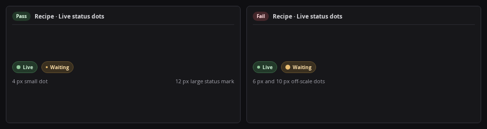

# Recipe: Live dot

Center an `8x8 px` pulsing `.dot` inside a `1lh` `.ico-svg` slot, or `16x16 px` standalone (`SPC001`, `ICN102`). Swapping idle glyphs and live dots shifts nothing, and visible text specifies the `aria-hidden` state.



```css
.dot { width: 8px; height: 8px; border-radius: 9999px; background: currentColor; flex: none; }
.dot-sm { width: 4px; height: 4px; }
.dot-lg { width: 12px; height: 12px; }
.ico-svg { display: inline-grid; place-items: center; width: 1lh; height: 1lh; flex: none; }
.ico-svg--solo { width: 16px; height: 16px; }
.ico-svg > .dot, .dot.live, .pill.warn .dot { animation: pulse var(--slow) var(--ease) infinite alternate; }
@keyframes pulse { from { opacity: 1; } to { opacity: 0.55; } }
@media (prefers-reduced-motion: reduce) {
  .ico-svg > .dot, .dot.live, .pill.warn .dot { animation: none; }
}
```

```js
// A live state takes the 1lh glyph slot of a status row so it keeps the row height
const liveDot = () => el("span", { class: "ico-svg", "aria-hidden": "true" }, el("i", { class: "dot" }));
```
