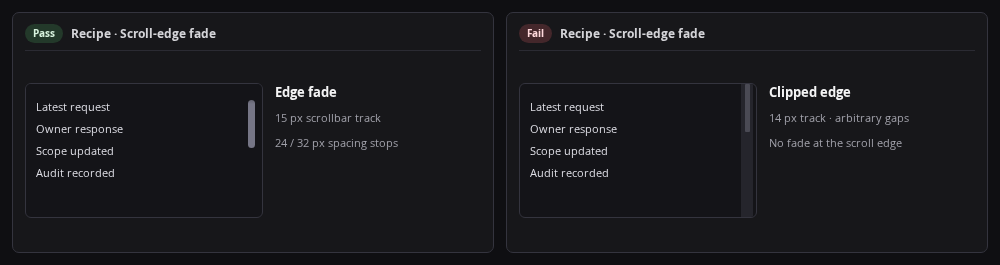

# Recipe: Scroll-edge fade

Fade scrollable containers and inputs (`24px` edge, `32px` ramp, `15px` scrollbar carve, `scroll-padding-block: var(--edge-fade)`). Keep non-scrollable containers and single-line inputs unmasked. Use `references/recipes/floating-overlay-scroll-fade.md` behind floating bars.
Keep clearance between a scroll-edge-fade region and adjacent non-overlapping siblings proportional to nearby Clause 6 and Clause 21 spacing.



```css
:root { --edge-fade: 24px; --edge-ramp: 32px; --scrollbar-carve: 15px; }
@property --edge-start { syntax: "<length>"; inherits: false; initial-value: 0px; }
@property --edge-end { syntax: "<length>"; inherits: false; initial-value: 0px; }
@media (prefers-reduced-motion: no-preference) {
  @supports (animation-timeline: scroll(self)) {
    .scroll-panel, textarea {
      scroll-padding-block: var(--edge-fade);
      mask-image:
        linear-gradient(to bottom, transparent, black var(--edge-start), black calc(100% - var(--edge-end)), transparent),
        linear-gradient(to left, black var(--scrollbar-carve), transparent var(--scrollbar-carve));
      mask-composite: add;
      animation: edge-start linear both, edge-end linear both;
      animation-timeline: scroll(self), scroll(self);
      animation-range: 0px var(--edge-ramp), calc(100% - var(--edge-ramp)) 100%;
    }
    @keyframes edge-start { from { --edge-start: 0px; } to { --edge-start: var(--edge-fade); } }
    @keyframes edge-end { from { --edge-end: var(--edge-fade); } to { --edge-end: 0px; } }
  }
}
```
