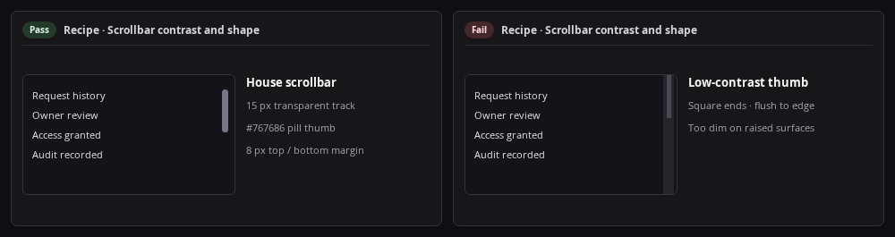

# Recipe: Scrollbars

Style scrollbars with a pill thumb (`var(--scrollbar-thumb)`) inset in a `15px` track (`transparent`) with `margin: 8px 0`, `9999px` pill radius, no arrow buttons (`::-webkit-scrollbar-button { display: none; }`), and keyboard-nav hover highlights (`:root[data-keyboard-nav="true"]`). Global `*` rule sets `scrollbar-width: thin` and `scrollbar-color: var(--scrollbar-thumb) transparent` for Firefox.



```css
::-webkit-scrollbar {
  width: 15px;
  height: 10px;
}

::-webkit-scrollbar-track,
::-webkit-scrollbar-corner {
  background: transparent;
  margin: 8px 0;
}

::-webkit-scrollbar-thumb {
  background: var(--scrollbar-thumb);
  border: 1px solid transparent;
  background-clip: padding-box;
  border-radius: 9999px;
}

:root[data-keyboard-nav="true"] ::-webkit-scrollbar-thumb:hover,
:root[data-keyboard-nav="true"] ::-webkit-scrollbar-thumb:active {
  background: var(--focus);
}

::-webkit-scrollbar-button {
  display: none;
  width: 0;
  height: 0;
}

* {
  scrollbar-width: thin;
  scrollbar-color: var(--scrollbar-thumb) transparent;
}
```