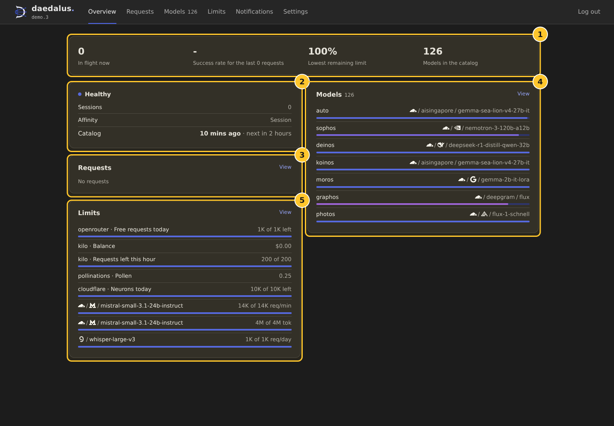
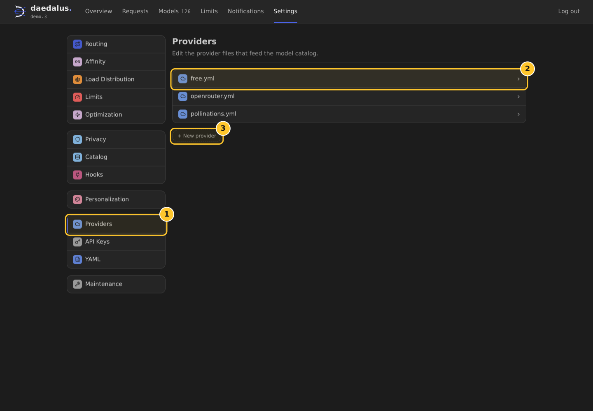
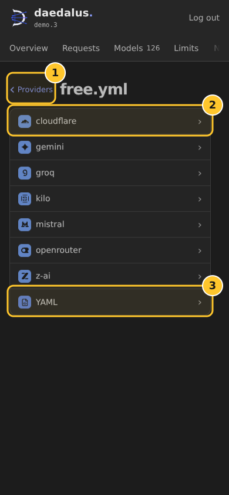
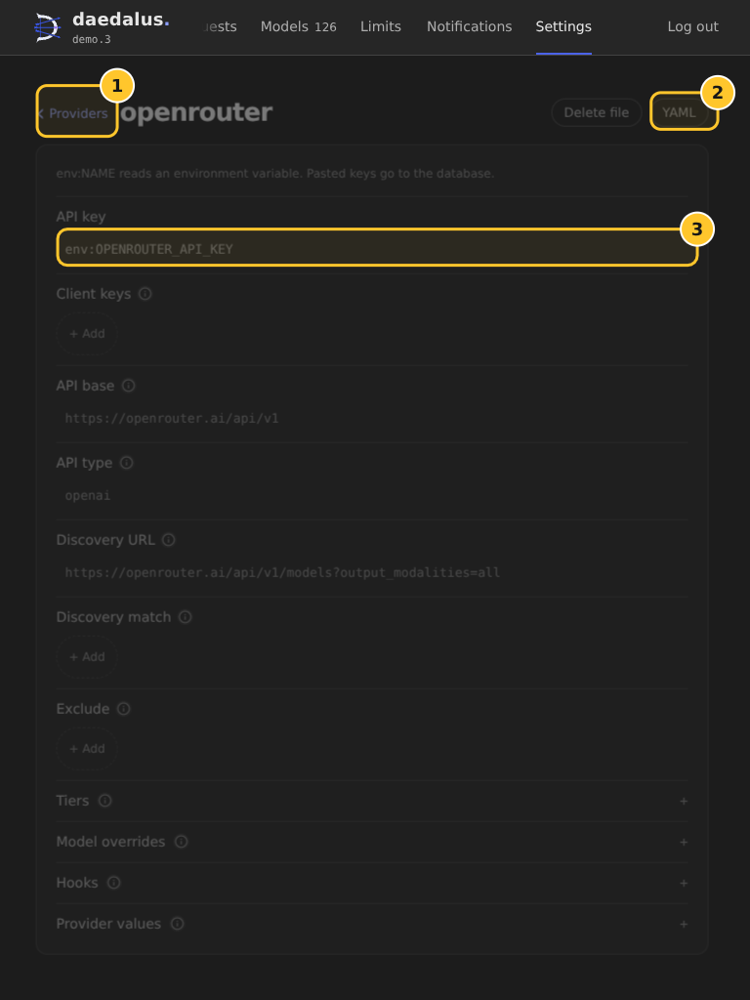

# Dashboard

Use the dashboard to monitor a running daedalus server and update its router and provider settings.

Open `http://SERVER_HOST:3357/`, replacing `SERVER_HOST` with the server address. Use the port configured for your installation if it differs from `3357`.

## Sign in

| Field | Value |
| --- | --- |
| Username | `DAEDALUS_USERNAME`, or `admin` when unset |
| Password | `DAEDALUS_PASSWORD`, or `DAEDALUS_MASTER_KEY` when unset |
| Remember me | Keeps the session for 30 days. Without it, the session ends after 12 hours. |

See [Configuration](configuration.md#environment-variables) for the environment variables.

## Pages

| Page | Use |
| --- | --- |
| Overview | Check server health, recent requests, model pools, and remaining limits. |
| Requests | Search recent and in-flight requests. Select a request to inspect its attempts. |
| Models | Search and filter the model catalog, then open a model for its details. |
| Limits | Review provider balances and the latest rate-limit headers. |
| Notifications | Review catalog rebuilds, model changes, update checks, and limit warnings. |
| Settings | Edit router settings, provider files, API keys, and other server options. |

## Overview

1. The summary shows in-flight requests, recent success rate, the lowest remaining limit, and catalog size.
2. The status card shows health, sessions, affinity, and catalog rebuild timing.
3. The Requests card links to recent activity.
4. The Models card shows each pool and its top model.
5. The Limits card shows balances and rate-limit values.

The screenshots show dark mode with sample data.

## Edit provider files

1. Open **Settings** → **Providers**.
2. Select a provider file.
3. If a file has multiple providers, select a name to open its form. A file with one provider opens its form directly, as `openrouter.yml` does.

1. Open **Providers** in the Settings list.
2. Select `free.yml` to open its provider list when it contains multiple providers.
3. Select **+ New provider** to create a standalone provider file. Enter a name with lowercase letters, digits, or dashes.

1. **Providers** returns to the provider file list.
2. Select a provider name to open its form.
3. Select **YAML** to edit the full file.

1. **Providers** returns to the provider file list.
2. Select **YAML** to open the text editor.
3. Select a value row, such as **API key**, to edit it. In the dialog, select **Save** to apply the change. **Cancel** or Escape leaves the saved value unchanged.

The dashboard shows **Delete file** for standalone provider files. The main `free.yml` file has no delete action. A deleted provider's models remain in the catalog until the next rebuild.

Use `env:NAME` to read a provider key from an environment variable. The dashboard stores a pasted key in the server state database and writes a `db:NAME` reference in YAML.

## YAML drafts and saves

The editor keeps the draft when you change Settings sections. It also keeps the draft when you return through the provider list and reopen YAML. Select **Save** to write the YAML file. The dashboard asks before it discards unsaved changes when you switch between Form and YAML.

A successful provider save reloads the configuration and rebuilds the catalog. After a file edit outside the dashboard, select the **Catalog** row on **Overview** to rebuild the catalog.

## Router settings

Use the Settings sections to edit `config/daedalus.yml`. Select a value to open its editor. Choose **Save** to write the change. Switches, selections, and list edits save as you change them.

Open **YAML** to edit the full file. Select **Save** to write it.

On a phone, select a Settings section to open a separate page. Use the back label or the browser's Back action to return to the section list.

## Personalization

Open **Settings** → **Personalization** and choose **Dark**, **Light**, or **System**. **System** follows the device theme.

## API keys

Open **Settings** → **API Keys** to generate keys for clients that call `/v1`. Copy a key before you close the reveal panel. The dashboard shows the full value once.

Delete a key to revoke its access. Use the dashboard username and password to sign in.

## Troubleshooting

When a dashboard read fails, the page shows the server message and a **Retry** button. When a provider file has invalid YAML, the dashboard opens it in the YAML editor and shows an error. Correct the YAML, then select **Save**.

For provider configuration details, see [Configuration](configuration.md), [Providers](providers.md), and [Provider keys](provider-keys.md).
