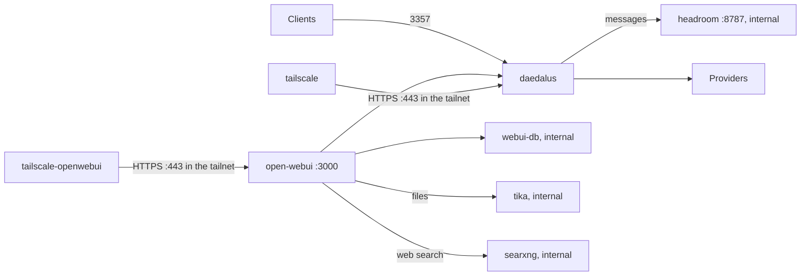

# Deployment

The reference deployment is a Raspberry Pi 4B with 8 GB of RAM. The compose file uses `slim` Docker images where they exist, to save space.

## Contents

- [Docker Compose](#docker-compose)
- [Image release](#image-release)
- [Dev image](#dev-image)
- [Optional services](#optional-services)

## Docker Compose

The install scripts show the first-install plan and ask `[y/N]`. Then they install Docker if it is missing: Docker Desktop with winget on Windows, or `get.docker.com` on Linux. Outside a git checkout, each run downloads the files of the newest `v*` tag, or of `main` when there is no tag. It refreshes unchanged managed Compose files and service defaults, while `.env`, [`config/`](../config), local overrides, and volumes stay.

They make `.env` with a new master key, then pull the daedalus image and start the containers.
With `--dev`, they use [`compose.dev.yml`](../compose.dev.yml). They build the image from the
source when the source is in the folder, and they pull `ghcr.io/nemoe7/daedalus:dev` when it
is not. See the
[README](../README.md#quick-start).

### Managed and local Compose settings

Each service reads shipped values from `services/SERVICE/defaults.env`. The installer manages these files and the two Compose files. Do not edit them in a standalone installation.

Put a service environment override in the ignored `services/SERVICE/local.env` instead. Keep credentials and installation-wide values in the ignored root `.env`.

For example:

```dotenv
# services/open-webui/local.env
AIOHTTP_CLIENT_TIMEOUT=900
```

Set the two published host ports in the root `.env`:

```dotenv
DAEDALUS_HOST_PORT=3358
OPENWEBUI_PORT=3001
```

These values change only the host side of each mapping. The internal daedalus and Open WebUI ports stay at `3357` and `8080`. Use these variables instead of a Compose override because Compose can merge port lists and keep the original mapping active.

Use the ignored `compose.override.yml` for other structural changes such as volumes, labels, devices, networks, or image overrides. Normal production commands load that standard Compose override automatically. The installers also load it, including with `--dev`. A manual dev start uses `docker compose -f compose.dev.yml -f compose.override.yml up -d`.

A standalone installer records managed hashes in `.daedalus-state/managed-files.sha256`. It replaces a file only when it still matches the recorded or a known shipped version. If a managed file has local edits, the installer preserves it, writes the new version under `.daedalus-state/updates/`, and stops before Docker.

Move the customization to `local.env` or `compose.override.yml`, install the candidate managed file, and rerun. The installer does not use a per-key merge.

The Docker and git commands below are the same in cmd, PowerShell, and bash.

| Task | Command |
| --- | --- |
| Start | `docker compose up -d` |
| Update | `git pull`, then `docker compose pull`, then `docker compose up -d` |
| Build from the source | [`compose.dev.yml`](../compose.dev.yml) builds `daedalus:dev` from the source at each start, with each command. Needs the source in the folder. |
| Run the dev image | Run the [platform installer](../README.md#quick-start) with `--dev` without the source. It downloads the files of `main` and pulls `ghcr.io/nemoe7/daedalus:dev` at each start. |
| Stop | `docker compose down` |
| Log | `docker compose logs -f api` |
| Rebuild catalog | Overview status card Catalog action, or `docker compose exec api daedalus catalog` |
| Run the CLI on the host | `daedalus catalog` probes `DAEDALUS_URL`, or `DAEDALUS_HOST` and `DAEDALUS_PORT`, and asks a live server to rebuild. A refused request stops the command, and `--force` rebuilds the store here. `dump` reads the shared state folder. Run hook commands through the container CLI. |
| Dump catalogs/models | `docker compose exec api daedalus dump catalog`, `models`, `enrichments`, or `all`. Files go to `.daedalus-state/dump` |
| Update the hook files | `docker compose exec api daedalus hooks update` reads the `hooks.sources` repos and writes `hooks.lock.json`. `daedalus hooks verify` then reads the lock and loads each file. See [Hooks](hooks.md#sources-and-the-lock) |

`dump` defaults to JSON. Add `-f csv` (also `--fmt` or `--format`) for CSV. Catalog refresh saves provider
and enrichment snapshots. Without `--refresh`, dumps read saved data and never fetch.

Add `--refresh` to `dump catalog`, `dump models`, `dump enrichments`, or `dump all` to fetch before exporting. A live server
requires its master key and returns the completed files, not the local CLI store. The command waits
up to 300 seconds for the server.

Only a connection refusal from the implicit local address permits a local refresh. An explicit
`DAEDALUS_URL`, a remote host, an HTTP refusal, or a timeout never causes a second local rebuild.
A required fetch failure stops the command without replacing dump files or removing retained model rows.

The models dump carries the tier of each row. JSON dumps wrap the original payload under `data` and
add UTC ISO 8601 timestamps with a `Z` suffix. `exported_at` gives the file generation time.

Provider and enrichment dumps add `fetched_at` from the saved snapshot. `dump enrichments` writes
`litellm-{provider}` and `modelschemas-{provider}` files. Model dumps add `built_at` from the model
store, or `null` without a build. A build time does not give the fetch time of each retained model row.

CSV output does not change.

The dashboard starts while the initial catalog builds in a worker thread. `serve --catalog` also uses a
background build. Existing models remain available during a rebuild. On a first install, model requests
cannot succeed until models are available.

Startup, manual, scheduled, and config-save builds use the same worker-thread path, including the
catalog diff and its saved event.

Saving provider YAML in the dashboard rebuilds the model list from cache. After editing files outside the dashboard, click Catalog to fetch and rebuild.

| Item | Value |
| --- | --- |
| Container | `daedalus-api`, with the health check of the image on `/health` |
| Image | `ghcr.io/nemoe7/daedalus:latest`, for `linux/amd64` and `linux/arm64` |
| Port | `DAEDALUS_HOST_PORT`, default `3357`. The container port stays `3357`. |
| State | `./.daedalus-state` (model store, API keys, weights, sessions) |
| Config | `./config`, read-write. The dashboard edits these files. |
| Hooks | The `hooks` named volume at `/app/hooks`, with the hook files and `hooks.lock.json`. |
| User | `DAEDALUS_UID` and `DAEDALUS_GID`, both default `1000` |
| Headroom | `HEADROOM_URL`, default `http://headroom:8787`. The messages go there first. |

### Writable hook storage

Both Compose modes mount the `hooks` named volume at `/app/hooks`. Docker copies the image files into a new empty volume. The volume keeps hook files and source records when Compose replaces the container. Image updates do not replace files in an existing volume.

Use **Take** in Settings or `docker compose exec api daedalus hooks update` to update installed hooks. `docker compose down -v` deletes the volume and its hook files.

Before updating a container without persistent hook storage, copy its files to a backup folder. The installer does not migrate them. This command works in cmd, PowerShell, and bash:

```console
docker cp daedalus-api:/app/hooks ./hooks-backup
```

UID 1000 owns `/app/hooks` in the image. A different `DAEDALUS_UID` needs a writable hook folder to install or update files.

Create `./.daedalus-state/hooks` on the host. Give the configured `DAEDALUS_UID` and `DAEDALUS_GID` write access to that folder before starting Compose. Add this mount to the `api` service in the ignored `compose.override.yml`:

```yaml
services:
  api:
    volumes:
      - ./.daedalus-state/hooks:/app/hooks-local
```

Set `dir` in the existing `hooks` group of `config/daedalus.yml`, and keep its other keys. Update explicit hook paths and `hooks.order` entries to use the new folder.

```yaml
hooks:
  dir: hooks-local
```

`hooks.dir` accepts one folder name, not a nested path. The new folder starts without the image's hook files. Use **Take** on the hook source in Settings to install the selected files. daedalus does not move existing hooks or change folder ownership automatically.

## Image release

A successful **Gemini Release Draft** approval starts the `release` job of [`.github/workflows/docker.yml`](../.github/workflows/docker.yml) with the approved `v*` tag. The workflow publishes `ghcr.io/nemoe7/daedalus:TAG` and `ghcr.io/nemoe7/daedalus:latest`. A proposal-only Gemini run does not build an image. A manual image build is also available from the Actions tab.

| Task | Command |
| --- | --- |
| Release | Run **Gemini Release Draft** and approve it. The approval tags `v*` and builds the image. |
| Manual image build | Run **Docker** in the Actions tab, select `release`, and enter an existing `v*` tag. |
| Use 1 release | Set `image:` of the `api` service in [`compose.yml`](../compose.yml) to `ghcr.io/nemoe7/daedalus:v0.1.0`. |

## Dev image

A successful **CI** run on `main` starts the `Docker` workflow in [`.github/workflows/docker.yml`](../.github/workflows/docker.yml). When commits since the last published `dev` image touch `daedalus/`, `config/`, `hooks/`, `pyproject.toml`, `uv.lock`, `Dockerfile`, or `.dockerignore`, it publishes `ghcr.io/nemoe7/daedalus:dev` and `ghcr.io/nemoe7/daedalus:dev-COMMIT`. Each publish keeps the newest 10 `dev-COMMIT` versions, skips `latest`, and keeps all `v*` tags. Commits outside CI paths or shipped image paths publish no image.

| Task | Command |
| --- | --- |
| Dev image | Push to `main`. CI passes, then **Docker** publishes `dev`. |
| Manual dev image build | Run **Docker** in the Actions tab and select `dev`. |
| Use the dev image | Use the [platform installer](../README.md#quick-start) with `--dev` without the source, or set `image: ghcr.io/nemoe7/daedalus:dev` in [`compose.yml`](../compose.yml). |

The dev image tracks `main`. Its code has no review. Run it for new-commit checks, not for a
release. `DAEDALUS_DEV_IMAGE` and `DAEDALUS_DEV_PULL` change the image and the pull policy, and
`DAEDALUS_VERSION` is the version under the logo.

## Optional services

Set `COMPOSE_PROFILES` in `.env`. For example, `COMPOSE_PROFILES=webui,tailscale-openwebui,headroom` starts Open WebUI, its separate Tailscale service, and Headroom.



| Profile | Service | What it does |
| --- | --- | --- |
| `webui` | `open-webui`, `webui-db` | Chat UI on host port `OPENWEBUI_PORT`, default `3000`, with daedalus as its OpenAI API. |
| `tika` | `tika` | Reads PDF and Office files for Open WebUI, with OCR. No port on the host. |
| `search` | `searxng` | Web search for Open WebUI. No port on the host, no key. |
| `headroom` | `headroom` | Compresses the messages before daedalus sends them. No port on the host. |
| `tailscale` | `tailscale` | Publishes daedalus to your tailnet over HTTPS. |
| `tailscale-openwebui` | `tailscale-openwebui` | Publishes Open WebUI to its own Tailscale device over HTTPS. Enable both the `webui` and `tailscale-openwebui` profiles. |

The installers ask for profiles only when `.env` is absent. If you decline Open WebUI, they skip Tika, SearXNG search, and Open WebUI Tailscale. Updates keep the existing `COMPOSE_PROFILES` value.

### Open WebUI

| Setting | Value |
| --- | --- |
| Host port | `OPENWEBUI_PORT`, default `3000`. The container port stays `8080`. |
| API base (`OPENAI_API_BASE_URL`) | `http://api:3357/v1` |
| API key (`OPENAI_API_KEY`) | `OPENWEBUI_API_KEY`, else `DAEDALUS_MASTER_KEY` |
| `ENABLE_OLLAMA_API` | `false`. Every model comes from daedalus. |
| First user | Becomes the Open WebUI admin |
| `OPENAI_API_CONFIGS` | Connection `0` sends `X-OpenWebUI-Chat-Id: {{CHAT_ID}}` for session affinity and [try again](architecture.md#try-again). |
| `ENABLE_FORWARD_USER_INFO_HEADERS` | `false`. Open WebUI does not send the user's name, email address, stable user ID, or role. |
| `WEBUI_SECRET_KEY` | From `.env`. Without it, each new container makes a new key, and all logins end. |
| `AIOHTTP_CLIENT_TIMEOUT` | `600`, the same as `limits.request`. The Open WebUI default is 300 s. |
| `TASK_MODEL_EXTERNAL` | `daedalus/auto`, for titles, tags, and follow-ups |
| `AUDIO_STT_ENGINE`, `AUDIO_STT_MODEL` | `openai` and `daedalus/graphos`. Speech to text goes to daedalus, not to a local Whisper. |
| `ENABLE_IMAGE_GENERATION`, `IMAGE_GENERATION_MODEL` | `true` and `daedalus/photos` |
| `ENABLE_IMAGE_EDIT`, `IMAGE_EDIT_ENGINE`, `IMAGE_EDIT_MODEL` | `true`, `openai`, and `daedalus/photos`. Only the photos models with image input take an edit request. |
| `AUDIO_STT_OPENAI_API_BASE_URL`, `AUDIO_STT_OPENAI_API_KEY`, `IMAGES_OPENAI_API_BASE_URL`, `IMAGES_OPENAI_API_KEY`, `IMAGES_EDIT_OPENAI_API_BASE_URL`, `IMAGES_EDIT_OPENAI_API_KEY` | The daedalus API base and key. Without them, speech and images go to OpenAI. |
| `VECTOR_DB`, `PGVECTOR_DB_URL` | `pgvector` in `webui-db`, for files, knowledge, and memory. `main-slim` supports no other vector store. |
| `ENABLE_MEMORY_BACKGROUND_REVIEW`, `MEMORIES_REVIEW_INTERVAL_TURNS` | `true` and `5`. After every 5th user turn, the chat model reviews the last turns and drafts the memories. |
| `RAG_OPENAI_API_BASE_URL`, `RAG_OPENAI_API_KEY`, `RAG_EMBEDDING_ENGINE`, `RAG_EMBEDDING_MODEL` | `http://api:3357/v1`, the daedalus key, `openai`, and `mistral/mistral-embed-2312`. `main-slim` has no local embedding model. |
| `CONTENT_EXTRACTION_ENGINE`, `TIKA_SERVER_URL` | `tika` and `http://tika:9998`. Without the `tika` profile, PDF, Office, and image files fail. Plain text skips it. |
| `ENABLE_WEB_SEARCH`, `WEB_SEARCH_ENGINE`, `SEARXNG_QUERY_URL` | `true`, `searxng`, and `http://searxng:8080/search?q=<query>`. Without the `search` profile, a web search fails. |
| `DEFAULT_MODEL_METADATA` | On in each new chat. An existing install: **Admin Settings > Models > Defaults**. |
| MCP servers | MCP tools need **Native** function calling. Tool requests skip the models without it. See [MCP](https://docs.openwebui.com/features/extensibility/mcp/). |
| Spoken replies | **Settings > Audio**: Web API or Kokoro.js. Gemini TTS allows 3 requests per minute. |
| `RAG_EMBEDDING_BATCH_SIZE`, `ENABLE_ASYNC_EMBEDDING`, `RAG_EMBEDDING_CONCURRENT_REQUESTS` | `32`, `true`, and `2`: 32 chunks in each call, 2 calls at a time, inside the free Mistral limits |

After a change of `personalization.audio` or `personalization.images` in [`config/daedalus.yml`](../config/daedalus.yml), override `AUDIO_STT_MODEL`, `IMAGE_GENERATION_MODEL` or `IMAGE_EDIT_MODEL` in `services/open-webui/local.env` and update **Admin Settings**. Also change the pool names in the Kilo and Open WebUI model settings.

Open WebUI reads most of these settings only on the first start with a new data volume. After that, the values in **Admin Settings** apply. On an existing install, set them there.

For an existing or separate Open WebUI install:

1. Open **Admin Settings > Connections**, and edit the daedalus OpenAI connection.
2. Open **Advanced**. Set **Custom Headers** to `{"X-OpenWebUI-Chat-Id":"{{CHAT_ID}}"}`.
3. Keep **Forward User Info Headers** off.

To check the services and settings:

1. `docker compose exec open-webui curl -s "http://searxng:8080/search?q=test&format=json" | head -c 200` shows JSON.
2. `docker compose exec open-webui curl -s http://tika:9998/version` shows the Tika version.
3. **Admin Settings > Documents** shows Tika at `http://tika:9998`, and embeddings `OpenAI` with `mistral/mistral-embed-2312`.
4. **Admin Settings > Web Search** shows `searxng`. **Code Execution** shows the code interpreter on, with `pyodide`.
5. **Admin Settings > Audio** and **Images** show `http://api:3357/v1`, with **Image Edit** on (`daedalus/photos`). An older database keeps its values: set them there.
6. Upload a PDF in a chat. The daedalus log shows `/v1/embeddings` requests.

| Feature | Tools for the model | Condition |
| --- | --- | --- |
| Web search | `search_web`, `fetch_url` | **Web Search** is on at the start of each chat. |
| Files | none | Tika reads each file at upload. Open WebUI adds matching text to the prompt. |
| Code | `execute_code` | On at chat start. Code runs in the browser (Pyodide). |

Keep **Function Calling** on **Native**, the Open WebUI default since v0.10.0. Native sends the tools in `tools`, and daedalus skips the models that cannot call tools. Legacy puts the tools in the prompt and calls tools only 1 time, before the answer.

The skills, filters, and tools of the [`integrations/openwebui`](../integrations/openwebui) folder have their own page: [Open WebUI integration](integrations/owui.md).

### Open WebUI database

The `webui` profile starts `webui-db` with Open WebUI.

| Setting | Value |
| --- | --- |
| Image | `pgvector/pgvector:0.8.6-pg18-trixie` |
| Content | Vectors for files, knowledge, and memory. Chats stay in the `open-webui` volume. |
| Password | `OPENWEBUI_DB_PASSWORD`, default `openwebui`. No port on the host. |
| Keys | `POSTGRES_USER`, `POSTGRES_PASSWORD`, and `POSTGRES_DB`, all `openwebui`. |
| Vector size | `PGVECTOR_INITIALIZE_MAX_VECTOR_LENGTH` is `1024`, the size of a `mistral/mistral-embed-2312` vector. A new model needs a new index. |
| Volume | `webui-db` |

### Tika

| Setting | Value |
| --- | --- |
| Image | `apache/tika:3.3.1.0-full`, with Tesseract OCR. Open WebUI uses the Tika 3 API by default. |
| Process | 1 Java process (`-noFork`) with a 512 MB heap, from `JAVA_TOOL_OPTIONS` |
| Out of memory | Java stops, and Docker starts Tika again |
| OCR | Tesseract reads the pages with little text on the Pi CPU. 1 scanned page takes many seconds. |
| Compose | `required: false` in the Open WebUI `depends_on`: `webui` starts without Tika. Compose 2.20 or later. The `env_file` form of `compose.yml` needs 2.24.0 or later. |

### SearXNG

| Setting | Value |
| --- | --- |
| Image | `searxng/searxng:latest` |
| Settings | [`services/searxng/settings.yml`](../services/searxng/settings.yml): JSON results on, the limiter off, so no Valkey |
| `SEARXNG_SECRET` | From `.env`. Empty by default: no SearXNG host port, the image proxy off. |
| `SEARXNG_QUERY_URL` | Open WebUI answers on `http://searxng:8080/search?q=<query>`. |
| `FORCE_OWNERSHIP` | `false`, for the read-only settings file. |
| When it searches | With Native function calling, the model decides. Tell it to search when it does not. |
| Blocks | SearXNG queries public search engines. They can block the Pi address or show a CAPTCHA. |

### Headroom

| Setting | Value |
| --- | --- |
| Mode | `lossy_inline` |
| Switch | `optimization.enabled`, or `headroom: false` in a provider block or a model entry. |
| Timeout | 5 s. Then the original messages go to the provider. |
| Failure | daedalus sends the original messages. |
| Log | `saved=N` shows the saved tokens. |
| `HEADROOM_BEACON` | `off`. The anonymous upload of compression stats, on by default. |
| `HEADROOM_UPDATE_CHECK` | `off`. Compose pins the image version. |
| `HEADROOM_ALLOW_UNAUTHENTICATED_BIND` | `1`. Headroom binds only inside the Compose network. Do not publish its port without adding authentication. |
| `HEADROOM_COMPRESS_ALLOW_REMOTE` | `1`. Without it, Headroom answers the `api` container with a 404. |
| `HEADROOM_TELEMETRY`, `HOME`, `HEADROOM_WORKSPACE_DIR` | Telemetry `off`, and the workspace of the image user at `/home/nonroot`. |

### Tailscale

| Setting | Value |
| --- | --- |
| Auth key | `TS_AUTHKEY` for daedalus. `TS_AUTHKEY_OWUI` for Open WebUI, with a `TS_AUTHKEY` fallback. |
| Device name | `TS_HOSTNAME`, default `daedalus`. `TS_HOSTNAME_OWUI`, default `owui`. |
| daedalus | `https://TS_HOSTNAME.TAILNET.ts.net` |
| Open WebUI | `https://TS_HOSTNAME_OWUI.TAILNET.ts.net`, with the `webui` and `tailscale-openwebui` profiles. A phone microphone needs the HTTPS. |
| Funnel | Off: only your tailnet can connect. |
| `TS_AUTH_ONCE` | `true`. The state volume keeps the login, and the old auth keys, across restarts. |
| `TS_STATE_DIR`, `TS_SERVE_CONFIG` | `/var/lib/tailscale` and `/config/serve.json`. |
| Health | `TS_ENABLE_HEALTH_CHECK` and `TS_LOCAL_ADDR_PORT` at `127.0.0.1:9002`: `/healthz`. `docker ps` shows "unhealthy" when the device has no tailnet address. |
