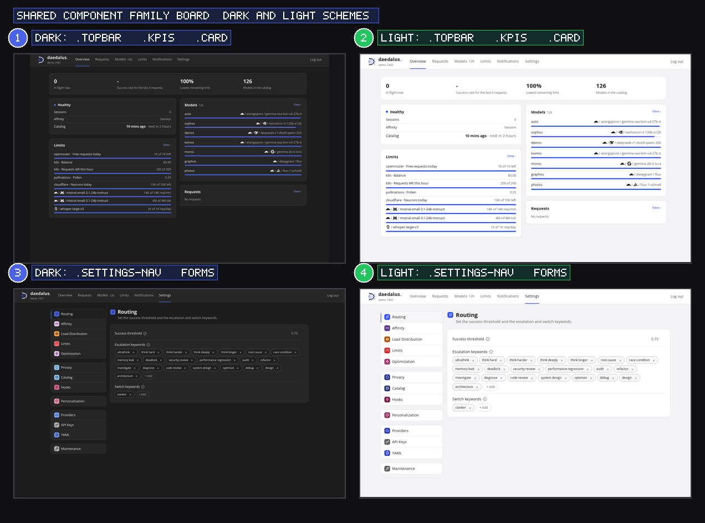

# Component Visual Catalog

**Parent**: [`docs/design.md`](../design.md)
**Source**: `daedalus/dashboard/ui/index.html`, `daedalus/dashboard/ui/style.css`, `daedalus/dashboard/ui/app.js`

## Component Reference Board

This composite board isolates 4 primary component groups from `daedalus/dashboard/ui/`. Callouts `1` through `4` mark the header strip, health bars, request toolbar, and settings controls.

## Component Inventory

| Callout | Component | Selector | Anatomy | States |
| --- | --- | --- | --- | --- |
| `1` | Header Bar and Navigation Tabs | `header.top`, `nav.tabs a` | Brand wordmark + version tag (`.brand`, `#version`), 6 route tabs with count pills (`#tab-models-count`, `#tab-notifications-count`), and `#logout` ghost button | Default, `:hover`, `:focus-visible`, `.on[aria-current="page"]` |
| `1` | KPI Stat Card | `.stats > .stat` | `22px` tabular numeral (`.stat-num`) above a `12px` muted caption (`.stat-label`) inside a `12px`-radius panel (`padding: 14px 16px`) | Default, live count update |
| `2` | Health Status Card | `#overview-health` | Status dot (`.dot.ok` or `.dot.bad`) + bold status label (`.health-head`), followed by hairline `.kv` rows (`Sessions`, `Affinity`, `Catalog`) | Healthy (`--ok`), Rebuilding, Degraded (`--bad`) |
| `2` | Pool and Quota Progress Row | `.pool-row`, `.limit-row` | Left model or quota name, right provider or remaining count, and a `6px` rounded `.bar` track (`--bar`) with a percentage fill (`--accent`, `--warn`, or `--bad`) | Normal (`< 80%`), Warning (`80%–95%`), Exhausted (`100%`) |
| `3` | Filter Toolbar and Live Toggle | `.toolbar`, `#live-toggle` | Search field (`input[type="search"]`), status and time `<select>` dropdowns, `#live-toggle` button with pulse icon, conditional `#request-clear` button, and `#request-count` hint | Idle, Filtered (`.off` removed from clear button), Live Paused (`aria-pressed="true"`) |
| `4` | Settings Navigation Menu | `.settings-menu`, `.settings-group` | Search input (`#settings-search`) above 4 grouped `.panel` lists of category buttons with `24x24px` colored icon tiles (`.cat-icon`) | Default, `:hover`, `.on`, filtered |
| `4` | Keyword Chip Editor | `.chips`, `.chip`, `.chip-add` | Flex-wrapped pill tags (`border-radius: 8px`, `background: var(--field)`) with inline remove button (`×`) and a dashed `+ Add` trigger button | Default, `:hover`, `:focus-visible`, modal add open |
| `4` | Setting Value Row and Dialog | `.setting-row[data-value]`, `<dialog id="modal">` | Label + info tooltip trigger on the left, current value on the right, opening `<dialog id="modal">` on click or `Enter` / `Space` | Default, `:hover`, `:focus-visible`, modal editing (`dashboard-states.png` callout `2`) |

## Related Visual References

- [Dashboard Visual Reference](dashboard.md)
- [Foundation Style Reference](styles.md)
