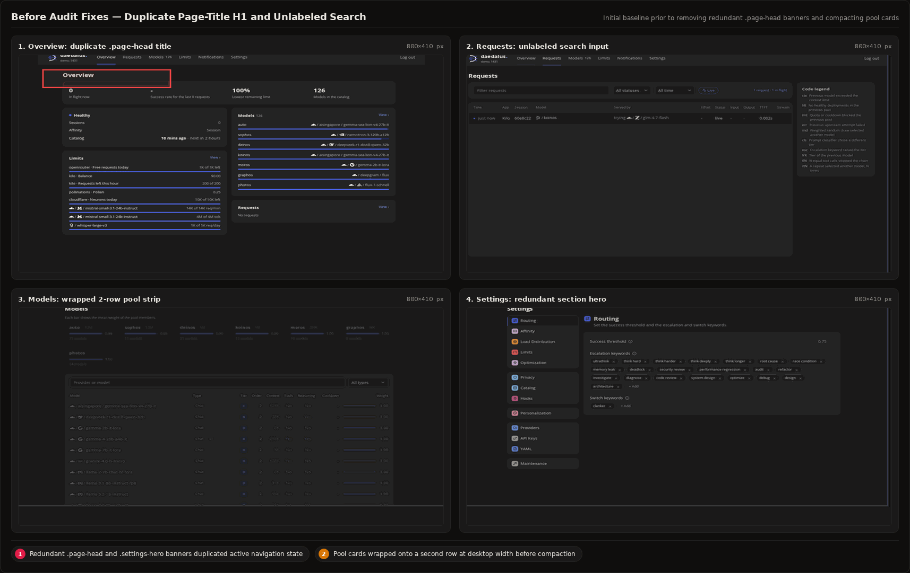
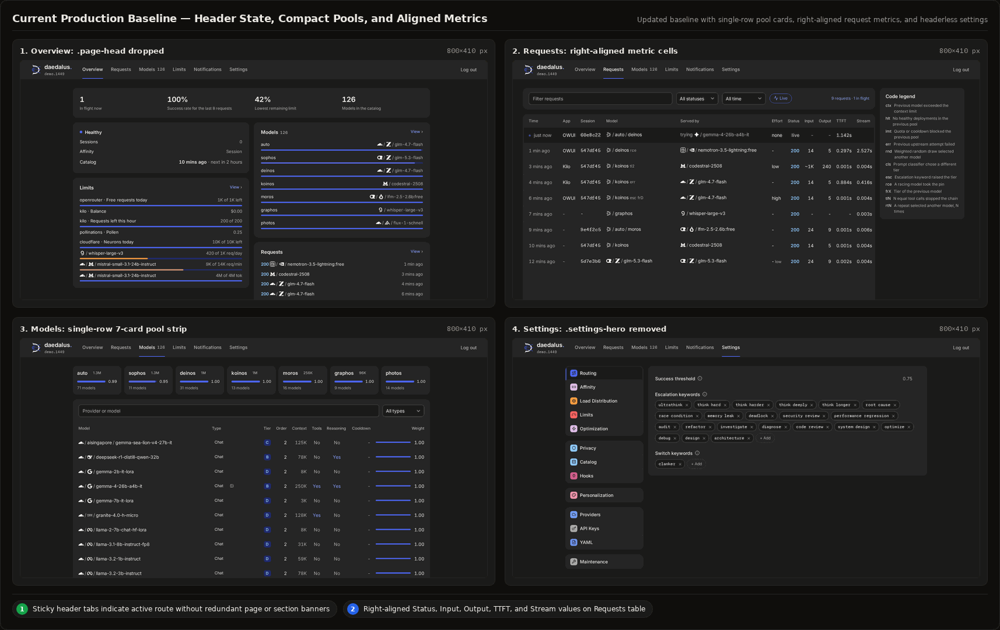
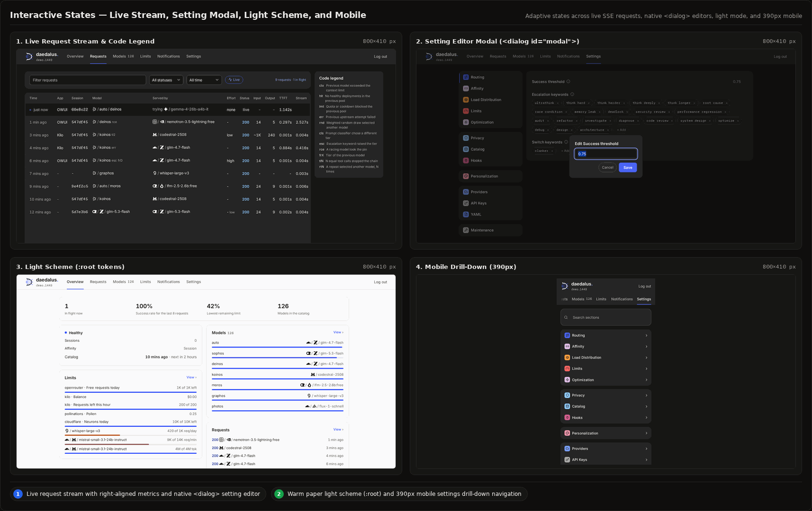
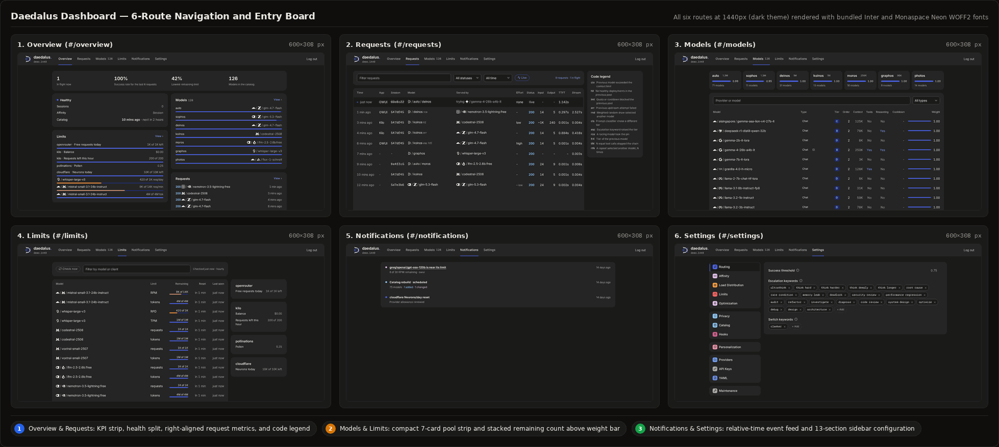
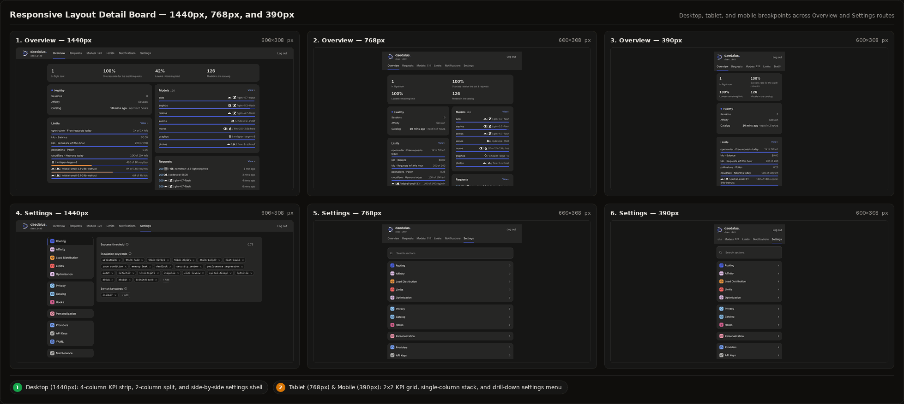

# Dashboard Visual Reference

**Parent**: [`docs/design.md`](../design.md)
**Source**: `daedalus/dashboard/ui/index.html`, `daedalus/dashboard/ui/style.css`, `daedalus/dashboard/ui/app.js`
**Routes**: `overview`, `requests`, `models`, `limits`, `notifications`, `settings`

## Viewport Specification

| Tier | Resolution | Aspect Ratio | Layout Structure |
| --- | --- | --- | --- |
| Desktop | `1280x800` / `1440x900` | `16:10` | Centered `1280px` shell with 4-column stat strip, 2-column split panels, and side-by-side settings shell |
| Tablet | `768x1024` | `3:4` | Wrapped tab strip, 2x2 stat grid, stacked single-column panels, and drill-down settings navigation |
| Mobile | `390x844` | `9:19.5` | Scrollable tab strip, 2x2 stat grid, compact 5-column request table, and mobile drill-down settings view |

## Default State (Before Header Cleanup)

This composite board shows the initial baseline with redundant `.page-head` title banners (`Overview`, `Requests`, `Models`, `Settings`) below the sticky header.

## Changed State (Current Production Baseline)

This composite board shows the current baseline without redundant `.page-head` banners. Sticky `.top` navigation tabs indicate the active route alone.

## Interactive States, Light Scheme, and Mobile Layout

This composite board shows 4 interactive and adaptive states. Callouts `1` and `2` show live requests and `<dialog id="modal">`, while `3` and `4` show light mode and `390px` mobile settings.

## Six-Route Navigation and Responsive Detail Boards

These composite boards show all 6 routes at `1440px` (`dashboard-overview.png`) and the `1440px`, `768px`, and `390px` responsive breakpoints (`dashboard-detail.png`).

## Annotated Component Map

| Callout | Board | Component | Selector | Role |
| --- | --- | --- | --- | --- |
| `1` | `dashboard-overview.png` | Overview KPI strip | `.stats > .stat` | Displays in-flight count, success rate, lowest remaining limit, and catalog model count |
| `2` | `dashboard-overview.png` | Health and Pool split | `.split` (`#overview-health`, `#overview-models`) | Pairs router health, session count, and limit bars with pool routing distribution bars |
| `3` | `dashboard-overview.png` | Requests table | `table.requests` | Lists live and completed requests with right-aligned `Status`, `Input`, `Output`, `TTFT`, and `Stream` cell values (`td.num`) |
| `4` | `dashboard-overview.png` | Code legend | `.code-legend` | Explains fallback and routing transition codes (`ctx`, `hlt`, `lmt`, `err`, `rnd`, `cls`, `esc`, `frX`, `tlN`, `rtN`) |
| `5` | `dashboard-overview.png` | Models catalog | `#models-list` | Groups discovered models below a single-row 7-card pool strip (`.pool-card`) |
| `1` | `dashboard-detail.png` | Limits quota list | `#limit-rows .weight.left` | Stacks a `12px` remaining count above a `4px` weight bar inside `44px` rows |
| `2` | `dashboard-detail.png` | Notifications list | `#notification-feed` | Displays router and provider events with relative timestamps |
| `3` | `dashboard-detail.png` | Settings shell | `.settings-shell` (`.settings-menu` + `.settings-pane`) | Splits the 13 settings sections into 4 grouped navigation cards and a headerless editor pane |

## State Coverage Matrix

| Component | Default | Hover | Focus-Visible | Active / Open | Empty / Disabled |
| --- | --- | --- | --- | --- | --- |
| `.tabs a` | Muted text (`--muted`) | Bright text (`--text`) | `2px solid var(--accent)` outline | `.on` with `2px` `--accent` bottom bar (`dashboard-changed.png`) | N/A |
| `table.requests tr` | Hairline top border (`--line`) | `5%` ink tint on `[data-chain-at]` rows | `2px solid var(--accent)` outline | Opens `<dialog id="chain-modal">` | `#requests-empty` (`dashboard-overview.png` panel 2) |
| `.setting-row[data-value]` | Surface `--panel` with value on right | `5%` ink tint | `2px solid var(--accent)` outline | Opens `<dialog id="modal">` (`dashboard-states.png` callout `2`) | `.off` / `:disabled` (`opacity: .45`) |
| `html` theme polarity | Dark (`data-theme="dark"`) | N/A | N/A | Light (`:root` default in `dashboard-states.png` callout `3`) | N/A |

## Responsive Layout Map

| Region | Desktop (`1280px`) | Tablet (`768px`) | Mobile (`390px`) |
| --- | --- | --- | --- |
| Header (`.top`) | Single row: brand, 6 tabs, logout button | 2 rows: brand + logout on row 1, scrollable tabs on row 2 | 2 rows: brand + logout on row 1, horizontally scrollable tabs on row 2 |
| Overview `.stats` | 4 columns (`repeat(4, 1fr)`) | 2x2 grid (`repeat(2, 1fr)`) | 2x2 grid (`repeat(2, 1fr)`) |
| Overview `.split` | 2 columns (`1.05fr 1fr`) | 1 column (`1fr`) | 1 column (`1fr`) |
| Requests `.requests-layout` | 2 columns (`1fr 260px`) | 1 column (table above `.code-legend`) | 1 column (5 core columns visible, `.code-legend` below) |
| Settings `.settings-shell` | 2 columns (`220px 1fr`) | Drill-down menu or pane with `#settings-back` | Drill-down menu list (`dashboard-states.png` callout `4`) |

## Related Visual References

- [Component Visual Catalog](components.md)
- [Foundation Style Reference](styles.md)
