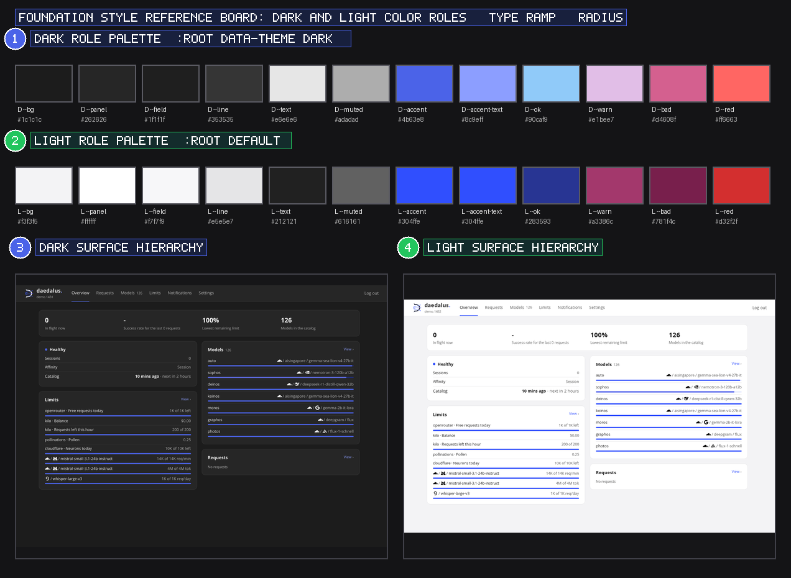

# Foundation Style Reference

**Parent**: [`docs/design.md`](../design.md)
**Source**: `daedalus/dashboard/ui/style.css`

## Style Reference Board

This composite board shows 4 style references. Callouts `1` and `2` show dark and light color swatches, while `3` and `4` compare dark and light Overview surfaces.

## Color Role Palette

Each swatch in rows `1` and `2` of `styles-board.png` maps directly to a CSS custom property in `daedalus/dashboard/ui/style.css`:

| Role | CSS Variable | Dark (`:root[data-theme="dark"]`) | Light (`:root`) | Usage |
| --- | --- | --- | --- | --- |
| Canvas background | `--bg` | `#1c1c1c` | `#f3f3f5` | `body` background |
| Elevated surface | `--panel` | `#262626` | `#ffffff` | `.panel`, `.stat`, `.modal` background |
| Input / code surface | `--field` | `#1f1f1f` | `#f7f7f9` | `input`, `select`, `textarea`, `.chip` fill |
| Hairline divider | `--line` | `#353535` | `#e5e5e7` | Panel borders and table row dividers |
| Control border | `--control-line` | `#565656` | `#b3b3b3` | Form control and ghost button borders |
| Primary text | `--text` | `#e6e6e6` | `#212121` | Primary copy, headings, and values |
| Muted text | `--muted` | `#adadad` | `#616161` | Secondary labels, hints, and timestamps |
| Primary accent | `--accent` | `#4b63e8` | `#304ffe` | Primary buttons, focus rings, and progress bars |
| Accent text | `--accent-text` | `#8c9eff` | `#304ffe` | Links, active tab indicators, and `View ›` actions |
| Healthy / OK | `--ok` | `#90caf9` | `#283593` | Healthy status dot and HTTP 200 badges |
| Warning | `--warn` | `#e1bee7` | `#a3386c` | Rate-limit badges and fallback transition pills |
| Fault / Bad | `--bad` | `#d4608f` | `#781f4c` | Upstream fault badges and depleted limit bars |
| Danger / Red | `--red` | `#ff6663` | `#d32f2f` | Destructive action borders and error banners |

## Typography Scale

| Role | Font Family | Size | Weight | Line Height | CSS Selector |
| --- | --- | --- | --- | --- | --- |
| KPI numeral | `var(--font)` (`Inter`, `tabular-nums`) | `22px` | `650` | `1.2` | `.kpi b` |
| Brand wordmark | `var(--font)` (`Inter`) | `18px` | `650` | `1.1` | `.brand` |
| Section / dialog heading | `var(--font)` (`Inter`) | `15px` | `600` | `1.35` | `.card h3`, `.modal h3` |
| Panel heading | `var(--font)` (`Inter`) | `14px` | `600` | `1.4` | `h2` |
| Body copy and controls | `var(--font)` (`Inter`) | `14px` | `400` | `1.5` | `body`, `input`, `select`, `button` |
| Monospace identifiers | `var(--mono)` (`Monaspace Neon`, `tabular-nums`) | `12px–13px` | `400–500` | `1.4` | `.mono`, `code`, `.yaml-box` |
| Table header and caption | `var(--font)` (`Inter`) | `12px` | `500` | `1.4` | `th`, `.kpi small`, `.hint`, `.chip` |

## Spacing, Radius, and Elevation Tokens

| Token / Property | Value | Usage |
| --- | --- | --- |
| `--radius` | `12px` | Outer border radius for `.panel`, `.stat`, and `<dialog class="modal">` |
| Control radius | `8px` | Inner border radius for `button`, `input`, `select`, and `.chip` |
| Pill radius | `999px` | Progress bars (`.bar`) and status dots (`.dot`) |
| Shell padding | `0 24px 48px` (`0 14px 32px` mobile) | Horizontal and bottom breathing room on `#app` |
| Panel gap | `12px–20px` | Grid gap across `.stats` (`12px`), `.requests-layout` (`14px`), `.split` (`16px`), and `.settings-shell` (`20px`) |
| Backdrop overlay | `rgba(0, 0, 0, .55)` | Native `dialog::backdrop` dimming layer |

## Related Visual References

- [Dashboard Visual Reference](dashboard.md)
- [Component Visual Catalog](components.md)
