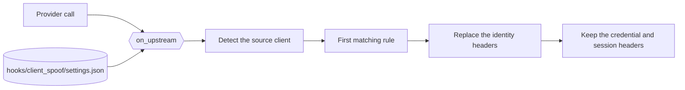

# The client identity rules

[`hooks/client_spoof.py`](../../hooks/client_spoof.py) presents one coding harness as another
through the outbound identity headers of each provider call.

| Item | Value |
| --- | --- |
| Scope | `global`: every provider call, on the `on-upstream` surface |
| Runs | `on-upstream` before each request to a provider |
| Reads | The rules in `.daedalus-state/hooks/client_spoof/settings.json` |
| Writes | The identity headers of the matched target client |
| Named by | The `hooks` list of a provider card or a model entry |
| Notes | The first rule whose source matches wins. An empty rule list changes nothing. |

The hook ships with no JSON file. The Hooks page creates `.daedalus-state/hooks/client_spoof/settings.json`
on the first save. Until then, the frontmatter default applies: 1 rule that presents Kilo as
OpenCode at the latest version.

## The rules

Each rule specifies a source client, a target client, and a version. The supported clients are
`owui`, `kilo`, and `opencode`. Each source stays unique, and the first matching rule wins.

| Column | Value |
| --- | --- |
| `source` | The client that sent the request: `owui`, `kilo`, or `opencode` |
| `target` | The client to present: `owui`, `kilo`, or `opencode` |
| `version` | The target version. `latest` resolves to the newest known version |

The hook detects a source from the request identity headers. It replaces only the target identity
headers: `User-Agent`, `X-Title`, `HTTP-Referer`, and `x-opencode-client`. It keeps credential and
session headers, such as `x-opencode-session` and `x-session-affinity`.

| Target | Identity headers |
| --- | --- |
| `opencode` | `User-Agent: opencode/latest/<version>/cli`, `X-Title: opencode`, `HTTP-Referer: https://opencode.ai/`, `x-opencode-client: cli` |
| `kilo` | `User-Agent: Kilo-Code/<version>`, `X-Title: Kilo Code`, `HTTP-Referer: https://kilo.ai/` |
| `owui` | `X-Title: Open WebUI`, `HTTP-Referer: https://openwebui.com/` |

## The version choices

The Hooks page fills the version field's `datalist` from the `options` function of the hook, through
`POST /ui/api/hooks/options`. The function reads each client registry off the request path: PyPI for
`owui`, and npm for `kilo` and `opencode`. It returns `latest` first, then the historical versions.

That single field also accepts any custom version directly. If a registry read fails, the hook uses
its known latest version.

## The Open WebUI branding license

Open WebUI places its `X-Title` and `HTTP-Referer` under a branding license. The license restricts
altering or removing the Open WebUI branding beyond its free tier. The operator who presents a
client as Open WebUI takes responsibility for that license. The hook does not grant a permission.

The other shipped hook files: [the auto reasoning effort and try-again rule](owui_auto_reasoning_effort.md),
[the served model line](served_model.md), and [the OpenRouter endpoint order](or_cheapest_output.md).
