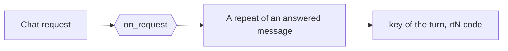
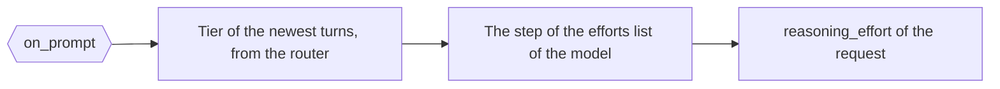

# Auto reasoning effort and try again

[`hooks/owui_auto_reasoning_effort.py`](../../hooks/owui_auto_reasoning_effort.py) holds 1
function per surface. `on_request` names the turn and repeat code, and `on_prompt` sets the
reasoning level. The optional Open WebUI Filter sends controls to this hook.

| Item | Value |
| --- | --- |
| Runs | `on_request` before a chat request. `on_prompt` before the first attempt. `on_chunk` on the final chunk |
| Writes | `value["key"]` and `value["code"]` on a repeat. `value["reasoning_effort"]` on a level. `usage.daedalus.line` on a chunk |
| Named by | its own frontmatter block: `surfaces: [on-request, on-prompt, on-chunk]`, `scope: client`, `targets: [OWUI]`. The `hooks` keys of [`config/daedalus.yml`](../../config/daedalus.yml) run it first |
| Serves | The Open WebUI client, from the `client` scope of its block, and `x-openwebui-chat-id` header |

Chart 1 shows the repeat key of `on_request`. Chart 2 shows the level of `on_prompt`.

## The level of a call

The `on_prompt` surface reads the heuristics v2 tier of the newest user turn and of the newest
model turn. Each turn of a chat gets its own level. The model part keeps at most `answer_chars`
characters, 500 by default, because a long answer would make the read too large. The `settings`
block of the file declares that cap, and the Hooks page sets it from 100 to 4000.

The tier indexes the `supported_reasoning_efforts` list of the model: `TIER-D` is step 0, the lowest effort the model accepts, and
each tier above is 1 step up. The key of the model, or of its block, wins first. Then the
list that the catalog holds for the model applies, and a provider with no list keeps its coded
default. The ladder stops at `high` and at the end of the list.

Client-supplied effort overrides that read. Conversation tier stays with
`daedalus/auto` routing, so this hook sets reasoning effort only.

| Event | The level |
| --- | --- |
| A new message | The read of the newest user turn and model turn |
| A try again | 1 step above the prior answer level, never below client-supplied effort |
| A try again after a model without reasoning | The read of the newest turns, with no step |
| Any request, at the top | `high` |

The base sets no effort of its own, and the `client` scope of the block serves the Open WebUI
client. The base never runs this file for a Kilo request or a generic client, so that client keeps
its own effort. A chain with no reasoning model gets no call and no effort. `upstream.without_reasoning` drops the field for a model the catalog marks as a model with no reasoning.

## Optional Filter

The [Auto reasoning effort Filter](../../integrations/openwebui/functions/auto_reasoning_effort.py) requires daedalus and this updated hook. It has no classifier of its own and does not work with a direct provider connection.

1. Install the updated hook in the configured `hooks.dir` on daedalus.
2. Import [auto_reasoning_effort.json](../../integrations/openwebui/imports/functions/auto_reasoning_effort.json) in **Admin Panel > Functions**.
3. Enable the Filter only for models on the daedalus connection. Keep the `x-openwebui-chat-id` custom header described below.
4. Set the Filter valves.

| Valve | Default | Effect |
| --- | --- | --- |
| `sensitivity` | `0.75` | Confidence threshold from 0 to 1. Higher values can select higher effort |
| `minimum_effort` | `none` | Automatic floor: `none`, `low`, `medium`, or `high` |

The hook removes `_daedalus_auto_effort` from the body during `on-request`, even when the prompt is empty or the model has no reasoning. It keeps the controls in the request value dict through the second call on a retry. No control changes the global routing threshold or its cache.

The floor selects the first supported effort at or above the requested minimum, or the highest supported effort when none reaches it. The existing ladder cap still applies. Explicit client effort, continuing turns and retries with a recorded level keep their existing priority rules.

Without valid sensitivity controls, the hook uses the existing routing threshold. The hook ignores invalid control values. The Filter changes only its private control field, not messages or explicit effort.

## The served line

The [served model hook](served_model.md) writes the line of the final chunk first.
Then `on_chunk` of this file puts the routed effort at its end, such as `Laguna S 2.1 · high`. An
effort of `none` leaves the line alone, and this file alone draws no line.

The files of a surface run in list order, and an installed file joins in name order. This name sorts
before `served_model.py`, so name the surface to make the override win:
`on-chunk: [hooks/served_model.py, hooks/owui_auto_reasoning_effort.py]`.

## The try again

Open WebUI sends `x-openwebui-chat-id` through the daedalus connection's custom headers. The bundled
deployment sets it to `{{CHAT_ID}}` without forwarding the user's personal fields.

The `on_request` surface names the turn from that header and the digest of the messages. A repeat of a
message that a model answered is a try again. daedalus steps 1 tier up for `daedalus/auto`, keeps a named
pool, and drops the models that answered. Then it calls the surface again with `count` filled in, and this
file writes the code of the request, `rt1`, `rt2`.

The same count reaches `on_prompt` as `retry`, so the level of a try again follows the same rule.
Without the header, a repeat is a new request. Without the file, a repeat of a message takes the
usual chain.

The other shipped hook files: [The served model line](served_model.md) and [the OpenRouter endpoint order](or_cheapest_output.md).
