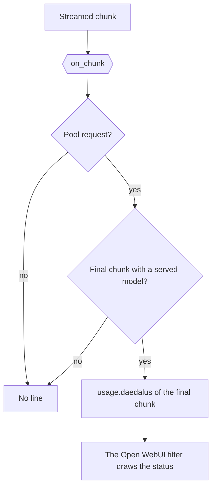

# The served model line

[`hooks/served_model.py`](../../hooks/served_model.py) reports the model that served a chat pool
request, in the final stream chunk, under `usage.daedalus`.

| Item | Value |
| --- | --- |
| Runs | `on-chunk`, on each streamed chunk of a `daedalus/auto` or pool request |
| Writes | `chunk["usage"]["daedalus"]` holds 3 keys (`line` display name, `model` served slug, `pool` name) |
| Named by | Its own frontmatter block: `surfaces: [on-chunk]`, `scope: client`, `targets: [OWUI]`. A `hooks.on-chunk` list in [`config/daedalus.yml`](../../config/daedalus.yml) runs it first |
| Shows | On the final chunk of each `daedalus/auto` or pool answer, including retries and repeats. The [filter](../integrations/owui/served_model.md) draws 1 row for each line, and its `when` Valve selects the rows |

`line` holds the catalog display name of `served`, such as `Laguna S 2.1`, and falls back to its
slug without the provider prefix. The [served model filter](../integrations/owui/served_model.md) draws `line` and can append the provider.

The [auto reasoning hook](owui_auto_reasoning_effort.md) overrides the line with the routed effort
when both files run.
Chat pools own no provider block, so the `hooks` list of a provider cannot name this file.
This file skips every model that is not `daedalus/auto` or a chat pool.

Also shipped: [the auto reasoning effort and try-again rule](owui_auto_reasoning_effort.md) and [the OpenRouter endpoint order](or_cheapest_output.md).
