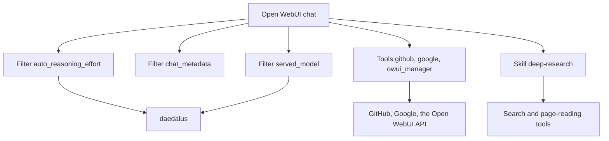

# Open WebUI integration

The [`integrations/openwebui`](../../integrations/openwebui) folder holds 1 directory for each Open WebUI plugin type. [`functions/`](../../integrations/openwebui/functions) holds the filters and the pipes, [`tools/`](../../integrations/openwebui/tools) holds the Workspace Tools, and [`skills/`](../../integrations/openwebui/skills) holds the skills.

The Python files are the editable sources. The [`imports/`](../../integrations/openwebui/imports) folder holds generated JSON downloads for the tools and filters. Import the skill folder without a generated JSON file.

| Plugin | Type | What it does |
| --- | --- | --- |
| [Deep research](owui/deep-research.md) | Skill | A portable research plan with source links |
| [`served_model.py`](owui/served_model.md) | Filter | Draws the daedalus served model line above the answer |
| [Auto reasoning effort](../hooks/owui_auto_reasoning_effort.md#optional-filter) | Filter | Sends per-request controls to daedalus and its auto-effort hook |
| [`chat_metadata.py`](owui/chat_metadata.md) | Filter | Puts 1 system message at the top, with the date, the clock, the timezone, the place, and the language |
| [`github.py`](owui/github.md) | Tool | The GitHub reads and writes, behind the permission gate |
| [`google.py`](owui/google.md) | Tool | Gmail, Calendar, Drive, and Docs, behind the permission gate |
| [`owui_manager.py`](owui/owui_manager.md) | Tool | The workspace: knowledge, skills, files, tools, and functions |



## Install

1. Download the JSON file for the tool or filter. Use **Import JSON** in **Workspace > Tools** or **Admin Panel > Functions**. Enable a filter after import. For the skill, use **Import folder** in **Workspace > Skills**, select the `deep-research` folder, then **Import selected**.
2. **Access** on the item: make it public, or give read access to each user. A user without read access does not see the plugin.
3. **Valves**: set the keys of the plugin. The page of each plugin names them.
4. **Workspace > Models**: turn the plugin on for a model. A tool id and an action id ride in the `meta.toolIds` and `meta.actionIds` lists of the model.
5. **The daedalus key**: the tools carry the keys of their services. The filters use the configured connection and hold no daedalus key.

A gated tool asks over the socket of the chat tab. `WEBSOCKET_EVENT_CALLER_TIMEOUT` is unset by
default, so the Open WebUI server waits without a timeout when the browser does not answer. Only
`timeout_seconds` ends that wait. A page refresh drops the dialog, the tool returns `denied: true`,
and the tool sends nothing.

## Generate import files

Edit the Python sources, not the generated JSON. The imports contain source code and display metadata, not saved valves or credentials. Configure keys and access after import.

Run from the repository root in cmd, PowerShell, or bash:

```text
python scripts/export_owui.py
python scripts/export_owui.py --check
```

The existing test suite checks the generated files against their sources. An import file installs one resource through its native page, not all plugin types at once.
