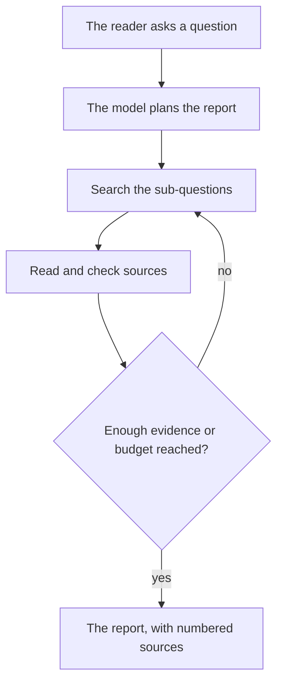

# Deep research skill

See [Open WebUI integration](../owui.md) for the other plugins.

[`integrations/openwebui/skills/deep-research/SKILL.md`](../../../integrations/openwebui/skills/deep-research/SKILL.md) contains portable research instructions, not code. It uses available search and page-reading tools without fixed tool names. The procedure checks sources, resolves gaps, and writes a report with numbered citations and explicit limits.

1. **Workspace > Skills**, the arrow next to **Create**, **Import folder**. Select the `deep-research` folder that contains `SKILL.md`, then **Import selected**.
2. **Access** on the skill: make it public, or give read access to each user. A user without read access does not receive the skill.
3. **Workspace > Models**, **Create**: select a base model with web-search and page-reading tools, and name it `Deep Research`. Select `deep-research` in **Skills** and select **Save**.
4. Enable native function calling for that model.
5. In a chat with `Deep Research`, keep **Web Search** on. Use `$deep-research` in a chat with another model.
