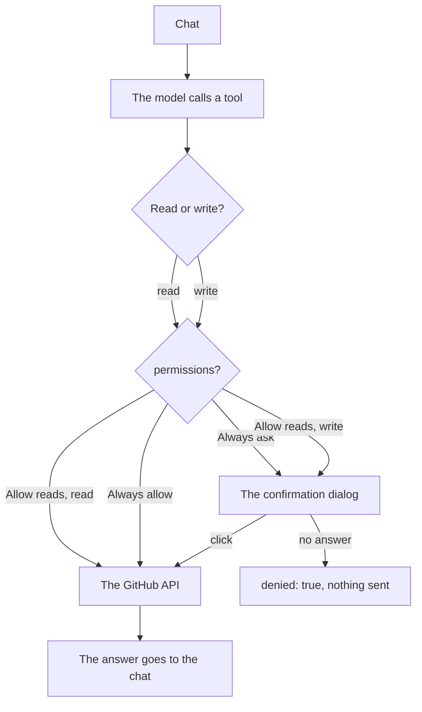

# GitHub tool

See [Open WebUI integration](../owui.md) for the other plugins.

Import [`github.json`](../../../integrations/openwebui/imports/tools/github.json) through **Workspace → Tools**, **Import JSON**. Then configure its valves and access.

[`integrations/openwebui/tools/github.py`](../../../integrations/openwebui/tools/github.py) is an Open WebUI
Workspace Tool: one Python file, standard library only, empty `requirements`. It holds the GitHub surface of
the reference connector. The `permissions` valve sets the gate. `Always ask`, the shipped default, holds every
call, including reads.

`Allow reads` frees the reads and holds the writes.

Each tool name and its docstring are the interface that the model reads. Open WebUI turns the text
above the first `:param` into the description of the tool. Each `:param name:` line becomes the
description of that argument in the JSON schema. So a param line is not a comment: it is the only
place that gives the model a rule, and it stays.

3 tools sit outside the connector list. `create_pr_with_files` writes a file list as 1 commit and opens or updates the pull request. `list_commits` reads the history of a path or a branch. `list_tree` reads the whole tree in 1 call.

3 security reads cover the alert lists: `code_scanning_alerts`, `secret_scanning_alerts` and `dependabot_alerts`. Each lists the alerts with filters, or reads 1 alert with its instances or locations. They need a token with the `security_events` scope, or the matching fine-grained read. Without it GitHub answers 403.

2 CI reads cover the checks. `list_github_check_runs` lists the check runs of a ref with the name, the status and the filter, or reads 1 run with its annotations. `list_workflows` lists the Actions workflows.

4 more reads ship:

| Read | Use |
| --- | --- |
| `actions_minutes` | The Actions minutes of an org or a user |
| `list_github_releases` | The releases, or 1 by id or tag |
| `list_github_tags` | The tags |
| `list_github_packages` | The packages of the signed-in user, a user or an org |

Gist management ships as 5 tools: `list_gists`, `fetch_gist`, and the gated writes `create_gist`, `update_gist` and `delete_gist`.

The 3 alert reads take gated writes: `update_code_scanning_alert`, `update_secret_scanning_alert` and `update_dependabot_alert` dismiss, resolve or reopen an alert.

1. Import the JSON file in **Workspace → Tools**, **Import JSON**.
2. **Valves**: set `github_token`, or set the `GITHUB_TOKEN` environment value. Set `permissions`. `Always ask` is the shipped default.
3. **Access** on the tool: make it public, or give read access to each user. A user without read access does not see the tool.

| Valve | Default | Meaning |
| --- | --- | --- |
| `github_token` | empty | The token. `GITHUB_TOKEN` is the fallback. |
| `max_output_bytes` | `32768` | Maximum UTF-8 bytes in one complete tool result, at least 1024 |
| `permissions` | `Always ask` | `Always ask` gates every call, reads included. `Allow reads` frees the reads and holds the gated calls. `Always allow` holds nothing. |
| `timeout_seconds` | `60` | The wait for the confirmation. A closed tab, no dialog, or a late answer reads as no. |
| `http_timeout_seconds` | `30` | The GitHub HTTP timeout. |
| `api_version` | `2022-11-28` | The `X-GitHub-Api-Version` header. |
| `max_files_per_commit` | `30` | The file limit of `create_pr_with_files`. |
| `max_tree_entries` | `2000` | The entry limit of `list_tree`. |

All 49 public reads use the same permission gate. Under `Always ask` each one waits for the click, so no repository line reaches the chat. `Allow reads` frees them.

`UserValves.mode` gives each user the same 3 levels, and `default` follows the tool valve. `UserValves.timeout_seconds` gives each user their own confirmation wait. A value of `0` keeps the tool valve.

The confirmation travels over the socket of the chat tab. `WEBSOCKET_EVENT_CALLER_TIMEOUT` is unset by default, so the Open WebUI server waits without a timeout when the browser does not answer. Only `timeout_seconds` ends that wait. A page refresh drops the dialog, the tool returns `denied: true`, and the tool sends nothing.

[`tests/integrations/openwebui/tools/test_owui_github_tool.py`](../../../tests/integrations/openwebui/tools/test_owui_github_tool.py) holds the tool surface, the gate and the error path.

## Output limits

`max_output_bytes` limits the complete serialized result, including metadata. It does not limit the HTTP download or the total chat context. Repeated calls can still fill a chat.

A result that does not fit returns `tool_output_too_large`, its original byte count, and complete identifiers that fit. The tool withholds the oversized payload instead of returning broken JSON. It does not repeat the operation. Do not repeat a write to recover omitted output.

Read only the pages needed for the task. Text offsets count characters, not bytes. A text page includes `offset`, `next_offset`, `total_chars`, and `truncated`. A null `next_offset` ends the read.

- `list_repositories` returns short records with complete IDs, URLs, branch names, and permissions. Pass `next_offset` as `page_offset` and keep `page_size` unchanged.
- `search_repositories`, `search_issues`, and `search_prs` return `next_page`. Keep the query and page size unchanged for later pages.
- Search stops at GitHub's 1,000-result limit. When `search_limited` is true, narrow the query to find more results. `incomplete_results` retains the API status.
- Issue and pull request summaries omit bodies and display aliases. Use their IDs or URLs with detail reads when needed.
- `list_commits` returns SHA, URL, author, date, and a subject of at most 200 characters. `message_truncated` marks omitted message text. It returns `page`, `per_page`, and `next_page` without fetching further pages.
- `search_commits` uses the same short records. Use its existing page arguments for further results.
- `fetch_blob` and `fetch_github_url` accept `offset` and `max_chars`. For a large commit, file, or diff, read its GitHub URL in text ranges.
- Text reads reduce the requested range when needed to fit the byte limit. JSON API responses read through a URL are text, so one range need not contain a complete JSON document.
