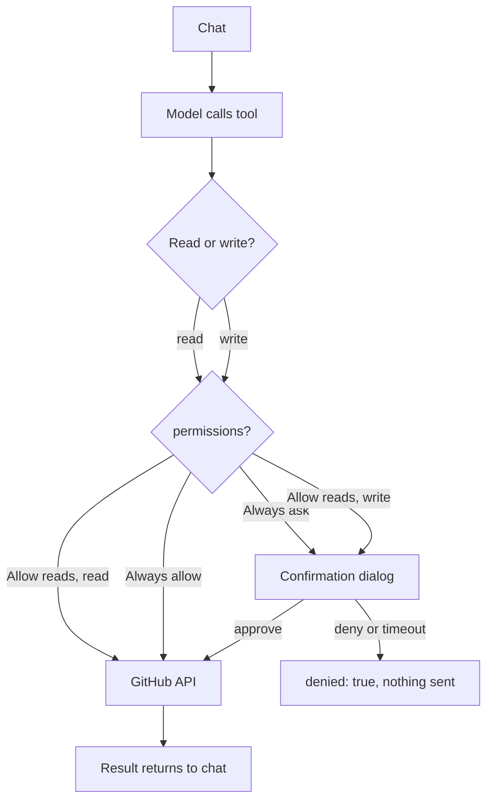

# GitHub tool

See [Open WebUI integration](../owui.md) for companion plugins.

Import [`github.json`](../../../integrations/openwebui/imports/tools/github.json) through **Workspace > Tools**, **Import JSON**, then configure valves and access.

[`integrations/openwebui/tools/github.py`](../../../integrations/openwebui/tools/github.py) is a single-file Open WebUI Workspace Tool using Python's standard library (`requirements` empty). It exposes 42 tools (23 reads and 19 writes) so `github.py` (42), `owui_manager.py` (25), and `google.py` (9) total 76 tools, leaving room below the 128-tool provider cap.

Each tool docstring defines the model schema. Text above the first `:param` becomes the tool description, and each `:param name:` line defines its argument rule.

## Tool groups (42 tools)

| Group | Reads | Writes |
| --- | --- | --- |
| Issues (7) | `fetch_issue`, `list_recent_issues` | `create_issue`, `update_issue`, `write_issue_comment`, `edit_assignees`, `edit_labels` |
| PRs and reviews (13) | `fetch_pr`, `fetch_pr_comments`, `fetch_pr_diff`, `list_pull_request_reviews` | `create_pull_request`, `update_pull_request`, `merge_pull_request`, `create_pr_with_files`, `add_review_to_pr`, `dismiss_pull_request_review`, `request_pull_request_reviewers`, `write_review_comment`, `set_review_thread` |
| Files, trees, commits (8) | `fetch_github_file`, `fetch_github_url`, `list_tree`, `list_commits`, `fetch_commit`, `compare_commits` | `write_github_file`, `write_branch` |
| Repos, refs, packages, account (6) | `get_repo`, `list_repositories`, `list_repo_refs`, `list_github_releases`, `list_github_packages`, `inspect_github_account` | none |
| Search (1) | `search_github` (`issues`, `prs`, `repositories`, `code`, `commits`, `branches`) | none |
| Security alerts (2) | `list_security_alerts` (`code_scanning`, `secret_scanning`, `dependabot`) | `update_security_alert` |
| Checks and Actions (3) | `list_github_check_runs`, `inspect_workflow_run` | `rerun_failed_workflow_run_jobs` |
| Gists (2) | `read_gist` | `write_gist` |

- `fetch_pr` sets `include_diff=false` for metadata-only reads, while `fetch_pr_diff` switches across `diff`, `patch`, `files`, `filenames`, and single-file `file` patches.
- `update_pull_request` handles REST fields alongside `draft=true` or `draft=false` GraphQL toggles.
- `list_security_alerts` and `update_security_alert` require a token with `security_events` or matching fine-grained alert permissions.

## Setup and valves

1. Import `github.json` in **Workspace > Tools**, **Import JSON**.
2. Set `github_token` or `GITHUB_TOKEN`, and choose `permissions` (`Always ask` by default).
3. Grant public or per-user read access so users can see the tool.

| Valve | Default | Meaning |
| --- | --- | --- |
| `github_token` | empty | GitHub token, falling back to `GITHUB_TOKEN` |
| `max_output_bytes` | `32768` | Maximum UTF-8 bytes in one serialized tool result, minimum `1024` |
| `permissions` | `Always ask` | Default gate (`Always ask`, `Allow reads`, or `Always allow`) |
| `timeout_seconds` | `60` | Confirmation wait in seconds (`0` uses `60`) |
| `http_timeout_seconds` | `30` | GitHub HTTP timeout in seconds |
| `api_version` | `2022-11-28` | `X-GitHub-Api-Version` header value |
| `max_files_per_commit` | `30` | Maximum files per `create_pr_with_files` call |
| `max_tree_entries` | `2000` | Maximum entries returned by `list_tree` |

All 23 read tools share `_read`. Under `Always ask`, every read waits for confirmation before calling GitHub, while `Allow reads` runs reads directly and gates all 19 writes.

`UserValves.mode` accepts `default` and the three permission modes, while unknown runtime modes require confirmation. `UserValves.timeout_seconds` overrides `timeout_seconds` per user (`0` inherits the tool valve).

Confirmations travel over the active tab WebSocket. Because Open WebUI leaves `WEBSOCKET_EVENT_CALLER_TIMEOUT` unset by default, `timeout_seconds` bounds closed or refreshed tabs and returns `denied: true` without sending requests.

[`tests/integrations/openwebui/tools/test_owui_github_tool.py`](../../../tests/integrations/openwebui/tools/test_owui_github_tool.py) verifies the 42-tool surface, permission gates, consolidated modes, and error handling.

## Output limits

`max_output_bytes` caps each serialized tool response, metadata included. Oversized results return `tool_output_too_large`, byte counts, and complete identifiers that fit without repeating writes.

Text offsets count characters, not bytes. Paged text responses return `offset`, `next_offset`, `total_chars`, and `truncated`, where `null` `next_offset` marks completion.

- `list_repositories` returns compact summaries with IDs, URLs, default branches, and permissions. Pass `next_offset` as `page_offset` with constant `page_size`.
- `search_github` (`repositories`, `issues`, and `prs` scopes) returns `next_page`, stops at GitHub's 1,000-result cap, and sets `search_limited` when results exceed `1000`.
- `list_commits` and `search_github(scope="commits")` return compact 200-character subjects (`message_truncated` marks trimmed messages) with `page` and `per_page`.
- `fetch_github_file(blob_sha=...)` and `fetch_github_url` accept `offset` and `max_chars`, shrinking ranges automatically to fit `max_output_bytes`.
