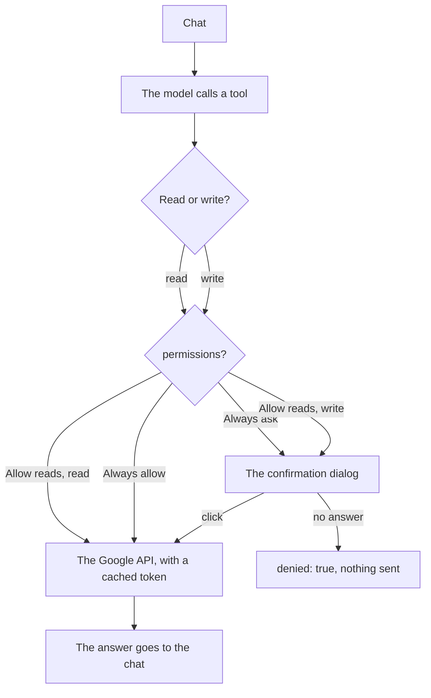

# Google tool

See [Open WebUI integration](../owui.md) for the other plugins.

Import [`google.json`](../../../integrations/openwebui/imports/tools/google.json) through **Workspace → Tools**, **Import JSON**. Then configure its valves and access.

[`integrations/openwebui/tools/google.py`](../../../integrations/openwebui/tools/google.py) is a second
Workspace Tool: 1 file, standard library only, empty `requirements`. It holds Gmail, Calendar, Drive and Docs.
The `permissions` valve sets the gate. `Always ask`, the shipped default, holds every call, including reads.

`Allow reads` frees the reads and holds the writes.

1. In the Google Cloud console, make an OAuth client of the type Desktop app, and turn on the Gmail, Calendar, Drive and Docs APIs.
2. Do the consent 1 time, with the scopes `gmail.readonly`, `gmail.send`, `calendar.readonly`, `calendar.events`, `drive.readonly` and `documents`. The reply holds the refresh token.
3. **Valves**: set `google_client_id`, `google_client_secret` and `google_refresh_token`. Set `permissions`. `Always ask` is the shipped default.

| Valve | Default | Meaning |
| --- | --- | --- |
| `google_client_id` | empty | The OAuth client id. |
| `google_client_secret` | empty | The OAuth client secret. |
| `google_refresh_token` | empty | The refresh token of the 1-time consent. The tool trades it for an access token and caches that for an hour. |
| `calendar_id` | `primary` | The calendar the agenda reads. |
| `max_results` | `10` | The default page of a list read. |
| `max_output_bytes` | `32768` | Maximum UTF-8 bytes in one complete tool result, at least 1024 |
| `permissions` | `Always ask` | `Always ask` gates every call, reads included. `Allow reads` frees the reads and holds the gated calls. `Always allow` holds nothing. |
| `timeout_seconds` | `60` | The wait for the confirmation. A closed tab, no dialog, or a late answer reads as no. |
| `http_timeout_seconds` | `30` | The Google HTTP timeout. |

The 6 reads are `search_mail`, `read_thread`, `read_message`, `agenda`, `search_files` and `read_document`. The 3 gated writes are `send_mail`, `create_event` and `append_to_document`.

The shipped `Always ask` holds every call, reads included, so no mail line and no one-time code reaches the chat without a click. `Allow reads` frees the reads and keeps the gate on the 3 writes. `Always allow` runs everything. `UserValves.mode` carries the same 3 values for one user, and `default` follows the tool valve.

`UserValves.mode` accepts `default` and the three permission modes only. Unknown runtime modes require confirmation.

[`tests/integrations/openwebui/tools/test_owui_google_tool.py`](../../../tests/integrations/openwebui/tools/test_owui_google_tool.py) holds the surface, the gate, the token cache and the error path.

## Output limits

`max_output_bytes` limits the complete serialized result, including metadata. It does not limit the HTTP download or the total chat context. Repeated calls can still fill a chat.

A result that does not fit returns `tool_output_too_large`, its original byte count, and complete identifiers that fit. The tool withholds the oversized payload instead of returning broken JSON. It does not repeat the operation. Do not repeat a write to recover omitted output.

Read only the pages needed for the task. Text offsets count characters, not bytes. A text page includes `offset`, `next_offset`, `total_chars`, and `truncated`. A null `next_offset` ends the read.

- `search_mail`, `agenda`, and `search_files` return `next_page_token`. Pass it as `page_token`. A null value ends the list.
- Keep the query, calendar, and page size unchanged for later pages. For `agenda`, also pass the returned `from` and `to` as `time_min` and `time_max`.
- `read_thread` requests metadata and returns message headers and snippets, not message bodies. Use its message `offset`, `max_results`, and `next_offset` to read further pages.
- `read_message` reads body text by message ID, `offset`, and `max_chars`.
- `read_document` accepts a character `offset` with its existing `max_chars` argument.
- Message and document ranges shrink when needed to fit the byte limit. Other lists can return an output-limit error when fields are too large, even with a small item count.
