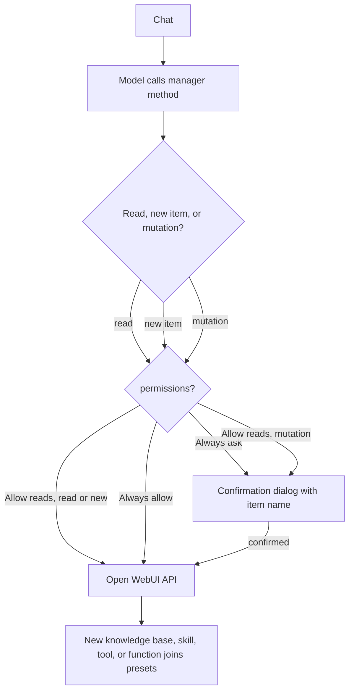

# Open WebUI manager tool

See [Open WebUI integration](../owui.md) for companion plugins.

Import [`owui_manager.json`](../../../integrations/openwebui/imports/tools/owui_manager.json) through **Workspace > Tools**, **Import JSON**. Then configure valves and access.

[`integrations/openwebui/tools/owui_manager.py`](../../../integrations/openwebui/tools/owui_manager.py) exposes 25 methods across five workspace groups: knowledge bases, files, skills, Workspace Tools, and Functions. Caller credentials come from each chat request, and `OWUI_API_BASE` sets the API root.

## Tool groups

| Group | Methods |
| --- | --- |
| Knowledge | `list_knowledge_bases`, `save_knowledge_base`, `delete_knowledge_base`, `list_knowledge_files`, `search_knowledge_files`, `read_knowledge_file`, `save_knowledge_file`, `delete_knowledge_file`, `manage_knowledge_directory` |
| Files | `list_files`, `read_file_content`, `save_file`, `delete_file` |
| Skills | `list_skills`, `show_skill`, `save_skill`, `delete_skill` |
| Tools | `list_tools`, `show_tool`, `save_tool`, `delete_tool` |
| Functions | `list_functions`, `show_function`, `save_function`, `delete_function` |

## Permissions and preset attachment

`permissions` supports three modes. `Always ask` gates every call, reads included. `Allow reads` permits reads and new-item creates (`create`, `import_url`, `ensure_path`, and new file uploads) while gating mutations, renames, toggles, and deletes. `Always allow` skips confirmation prompts.

New knowledge bases, skills, tools, and functions join selected model presets in one call. Each create reads writable presets, merges matching `meta` lists, and posts updates back. Presets without write access stay untouched and appear in the summary. `PRESET_MODELS` filters target presets by ID or name, and an empty value targets all writable presets.

## Open WebUI v0.12 skills

### Read skills and files

`show_skill` pages a skill's current version, file manifest, and `SKILL.md` text when `path` is empty. Passing `path` reads one UTF-8 supporting file by character offset or reports binary metadata without decoding bytes. `list_skills` lists workspace skills when `skill_id` is empty and pages snapshot files when `skill_id` is set.

### Create, update, and toggle skills

`save_skill` dispatches five `action` values: `create`, `import_url`, `update`, `update_files`, and `toggle`.

- `create` writes `SKILL.md` (`content`) plus optional UTF-8 supporting `files`.
- `update` replaces `SKILL.md` instructions on `skill_id`.
- `update_files` applies `put`, `move`, and `delete` operations against `expected_version_id` (reading the active version first when empty).
- `toggle` flips a skill's active flag.

### Import from a URL

`save_skill(action="import_url", url=...)` calls Open WebUI's native URL loader. It imports packages from GitHub repos, folders, `SKILL.md` URLs, raw Markdown, JSON, or ZIP archives, retaining text and base64 binary files.

Target URLs must use HTTPS, omit credentials, and match `TRUSTED_DOMAINS`. Open WebUI enforces redirect, SSRF, size, and package checks, and requires an administrator account for `/skills/load/url`. Imported skills attach to selected writable presets.

## Valves

`timeout_seconds` sets confirmation wait time, while `UserValves.mode` and `UserValves.timeout_seconds` provide per-user overrides (`0` inherits `Valves.timeout_seconds`). Unknown runtime permission modes require confirmation. Open WebUI v0.12.0 provides no per-tool toggle endpoint, so `save_tool(action="toggle", tool_id=...)` adds or removes `tool_id` across selected preset `toolIds` lists.

| Valve | Default | Meaning |
| --- | --- | --- |
| `OWUI_API_BASE` | `http://127.0.0.1:8080/api/v1` | Open WebUI API base URL |
| `PRESET_MODELS` | empty | Comma- or newline-separated preset IDs or names. Empty targets all writable presets |
| `max_output_bytes` | `32768` | Maximum UTF-8 bytes in one serialized tool result, minimum `1024` |
| `permissions` | `Always ask` | Default confirmation mode (`Always ask`, `Allow reads`, or `Always allow`) |
| `timeout_seconds` | `60` | Confirmation timeout in seconds, minimum `1` (`0` uses `60`) |
| `INSTALL_FETCH_TIMEOUT` | `60.0` | Timeout in seconds for `/skills/load/url` |
| `TRUSTED_DOMAINS` | `github.com,huggingface.co,githubusercontent.com` | Host allowlist for `save_skill(action="import_url")` |
| `SHOW_STATUS` | `true` | Emit running and completed status events for each call |

[`tests/integrations/openwebui/tools/test_owui_manager.py`](../../../tests/integrations/openwebui/tools/test_owui_manager.py) verifies all five groups, permission gates, preset attachment, path normalization, pagination, and v0.12 skill operations.

## Output limits

`max_output_bytes` caps each serialized tool response, metadata included. Oversized results return `tool_output_too_large`, byte counts, and complete identifiers that fit without repeating mutations.

Text offsets count characters, not bytes. Paged text responses return `offset`, `next_offset`, `total_chars`, and `truncated`, where `null` `next_offset` marks completion.

- `read_file_content`, `read_knowledge_file`, `show_skill` (without `path`), `show_tool`, and `show_function` return JSON strings with character ranges and continuation fields.
- `show_skill` with `path` returns line-oriented text with `offset` and `next_offset` capped to `max_output_bytes`.
- `list_knowledge_bases`, `list_knowledge_files` (`tree=false`), `list_skills` (without `skill_id`), and `list_files` (without `filename`) accept `page` and `offset`. Pass `next_page` and `next_offset` until `null`.
- `list_tools`, `list_functions`, and `list_skills` (with `skill_id` and optional `path`) page unpaged API lists locally via `offset`, `max_results`, and `next_offset`.
- `list_files` with `filename` accepts optional `path`, `offset`, and `max_results`, sending API `skip` and `limit` without file bodies.
- `list_knowledge_files` includes directories on API page `1` and preserves breadcrumbs, while `tree=true` renders a depth- and node-bounded tree.
