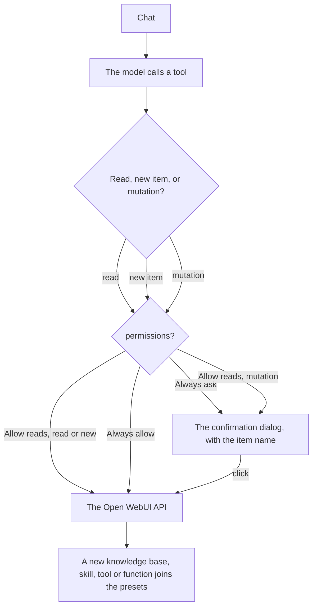

# The manager tool

See [Open WebUI integration](../owui.md) for the other plugins.

Import [`owui_manager.json`](../../../integrations/openwebui/imports/tools/owui_manager.json) through **Workspace > Tools**, **Import JSON**. Then configure its valves and access.

[`integrations/openwebui/tools/owui_manager.py`](../../../integrations/openwebui/tools/owui_manager.py) is 1 Workspace Tool over the whole workspace: knowledge bases, skills, the file library, the Workspace Tools, and the Functions. The caller token comes from the chat request, and the `OWUI_API_BASE` valve holds the base URL.

| Group | Tools |
| --- | --- |
| Knowledge | The 23 knowledge tools: bases, folders, files, search, tree. A file creation waits for the indexing |
| Files | `list_files`, `search_files`, `upload_file`, `rename_file`, `read_file_content`, `delete_file` |
| Skills | `list_skills`, `show_skill`, `list_skill_files`, `read_skill_file`, `install_skill`, `create_skill`, `update_skill`, `update_skill_files`, `toggle_skill`, `delete_skill` |
| Tools | `list_tools`, `show_tool`, `create_tool`, `update_tool`, `toggle_tool`, `delete_tool` |
| Functions | `list_functions`, `show_function`, `create_function`, `update_function`, `toggle_function`, `delete_function` |

The `permissions` valve holds 3 levels. `Always ask` gates every call, including reads. `Allow reads` frees the
reads and the new items, and holds the mutations and the toggles. `Always allow` holds nothing.

The question names the item.

A new knowledge base, skill, tool, or function joins the model presets in the same call. The tool reads each preset, merges the matching `meta` list and posts the record back. It skips a preset without write access and names it. The `PRESET_MODELS` valve selects the presets by id or by name, and an empty list serves each preset.

## Open WebUI v0.12 skills

### Read files

`show_skill` pages the current version, file manifest, and source as text. `list_skill_files` can inspect that version again. `read_skill_file` pages a UTF-8 file by character offset and reports binary-file metadata without decoding the bytes.

### Create and update files

`create_skill` accepts `SKILL.md` as `content` plus optional UTF-8 supporting `files`. The legacy name/content call remains valid. `update_skill` remains the simple instructions update. `update_skill_files` adds `put`, `move`, and `delete` operations while preserving untouched files.

Pass the version from `show_skill` as `expected_version_id` for optimistic concurrency. If this value is empty, the manager reads the current version immediately before saving. Agent-authored file writes are text-only.

### Import from a URL

`install_skill` uses Open WebUI's native URL importer. It imports every package in a GitHub repo, folder, or `SKILL.md` URL. It also imports packages in a raw Markdown, JSON, or ZIP URL. Imported packages retain all text and base64-encoded binary files.

The URL must use HTTPS, contain no credentials and match `TRUSTED_DOMAINS`. Open WebUI then applies its redirect, SSRF, size, and package validation. The native URL-loader endpoint requires an Open WebUI administrator. Successfully imported skills join the selected presets.

`timeout_seconds` sets the wait for the confirmation, and `UserValves.mode` plus `UserValves.timeout_seconds` give each user their own gate, where `0` keeps the tool valve. Open WebUI v0.12.0 has no per-tool toggle route, so `toggle_tool` toggles the tool id in the preset `toolIds` lists.

`UserValves.mode` accepts `default` and the three permission modes only. Unknown runtime modes require confirmation.

The preset helpers stay private, so Open WebUI builds no model tool spec for them. `/models/model/update` needs the owner, a write grant, or an admin.

| Valve | Default | Meaning |
| --- | --- | --- |
| `OWUI_API_BASE` | `http://127.0.0.1:8080/api/v1` | The Open WebUI API base |
| `PRESET_MODELS` | empty | The ids or names of the presets that take an attach. Empty serves each preset |
| `max_output_bytes` | `32768` | Maximum UTF-8 bytes in one complete tool result, at least 1024 |
| `permissions` | `Always ask` | `Always ask` gates every call, reads included. `Allow reads` frees the reads and the new items. `Always allow` holds nothing |
| `timeout_seconds` | `60` | Confirmation wait in seconds, at least 1. Tool value `0` uses 60 seconds. User value `0` uses the tool value |
| `INSTALL_FETCH_TIMEOUT` | `60.0` | The total wait for Open WebUI's native skill URL loader |
| `TRUSTED_DOMAINS` | `github.com,huggingface.co,githubusercontent.com` | The domains a skill install may fetch from |
| `SHOW_STATUS` | `true` | Show the tool name while an operation runs. Close the status when the call ends |

1. **Workspace > Tools**, **Create**, paste the file, **Save**.
2. **Access** on the tool: make it public, or give read access to each user.

[`tests/integrations/openwebui/tools/test_owui_manager.py`](../../../tests/integrations/openwebui/tools/test_owui_manager.py) holds the surface, gate, free reads, and creates, preset filtering and attachment, plus the v0.12 URL-import and multi-file request shapes.

## Output limits

`max_output_bytes` limits the complete serialized result, including metadata. It does not limit the HTTP download or the total chat context. Repeated calls can still fill a chat.

A result that does not fit returns `tool_output_too_large`, its original byte count, and complete identifiers that fit. The tool withholds the oversized payload instead of returning broken JSON. It does not repeat the operation. Do not repeat a write to recover omitted output.

Read only the pages needed for the task. Text offsets count characters, not bytes. A text page includes `offset`, `next_offset`, `total_chars`, and `truncated`. A null `next_offset` ends the read.

- `read_file_content` returns a JSON string with the file ID, text, and continuation fields.
- `read_knowledge_file`, `read_knowledge_file_at_path`, `show_skill`, `show_tool`, and `show_function` accept `offset` and `max_chars`. Their JSON strings contain a range of the rendered text and continuation fields.
- `read_skill_file` keeps its text format and character offsets. It also reduces the range to fit the byte limit.
- List results are JSON strings with complete records, `count`, `offset`, and `next_offset`. `max_results` defaults to 20 (cap 100, reduced by the byte limit).
- `list_knowledge_bases`, `list_knowledge_files`, `list_skills`, and `list_files` fetch one API page. Pass `next_page` and `next_offset` as `page` and `offset` until null.
- `list_tools`, `list_functions`, and `list_skill_files` page the unpaged API list locally. Pass `next_offset` as `offset` until null.
- `search_files` uses the API offset and limit without file content. Pass `next_offset` as `offset` (the final full page can precede an empty page).
- `list_knowledge_files` includes directories on API page 1 only and preserves breadcrumbs. `total_count` counts files, not directories.
- `list_skill_files` retains the snapshot `version_id` for later pages. Other lists can change between calls.
- Lists keep available access and state fields. A null `total_count` value means that the API gave no total.
- If one record cannot fit, the tool returns an output-limit error instead of a continuation that cannot advance.
